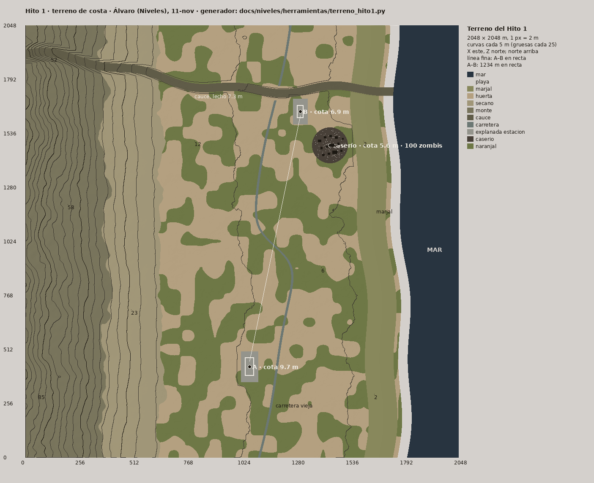

# Terreno del Hito 1 · 2 × 2 km de costa (Álvaro, Niveles, 11-nov ~23:10; v2 23:15: carretera en S y caserío al este)

Encargo: [hito1-reparto.md](../hito1-reparto.md). La costa está inspirada en la línea real Sagunt–Nules (Paula, `referencias-reales/hito1/logistica_y_vias_costa.md`, parte 2), sin calcarla: es llana entre naranjos, con la marjal y el mar al este, la sierra al oeste y un cauce que baja al mar.

## Archivos (`docs/hito1/terreno/`)

| Archivo | Qué es |
|---|---|
| `alturas_2049_u16le.raw` | Alturas de 2049 × 2049 muestras a 1 m (2048 m de lado), en uint16 little endian. La fila 0 es Z = 0 (sur) y la columna 0 es X = 0 (oeste). **h = −10 + v / 65535 · 128 m**, con el mar a la cota 0. En Unity: Terrain → Import Raw, 16 bit, Byte Order Windows, 2049 × 2049, tamaño 2048 × 128 × 2048 y el terreno colocado en Y = −10. SIN VERIFICAR en Unity si hay que voltear Z: el PNG va con el norte arriba y el RAW con el sur en la fila 0 |
| `alturas_2049_u16.png` | Las mismas alturas en PNG de 16 bits, con el norte arriba |
| `usos_2049.png` | Usos del suelo, 1 m por píxel, con el norte arriba. Ids: 0 mar, 1 playa, 2 marjal, 3 huerta, 4 secano, 5 monte, 6 cauce, 7 carretera, 8 explanada de estación, 9 caserío, 10 naranjal |
| `terreno_hito1.json` | Metadatos: tamaño, rango de alturas, ids de usos y cotas de las explanadas |
| `posiciones_hito1.csv` | Estaciones A y B, caserío, depósito de material, salida del pelotón, puente y **100 zombis** (x, y, z en m) |
| `carreteras_hito1.csv` | Polilínea de la carretera vieja (un punto cada 10 m, en mm, con la rasante, 7 m de ancho y los puntos del puente) |
| `obstaculos_hito1.csv` | 77 obstáculos de visión, con el mismo esquema que `sagunto_obstaculos_v1.csv` (mm), así que `NightSim.LosSceneFromCsv` lo lee tal cual: 13 edificios del caserío, 6 tapias de 1,6 m, 56 parcelas de naranjos (3,5 m; tapan la vista pero no el paso) y los 2 estribos del puente |
| `plano_cotas_hito1.png` | Plano con curvas cada 5 m (gruesas cada 25), cotas y posiciones |

Generador: `docs/niveles/herramientas/terreno_hito1.py`. Es determinista: con la semilla 20261111 sale lo mismo en cualquier máquina. Se ejecuta con `python3 -I terreno_hito1.py <carpeta>`.

## Planta (X este, Z norte, metros)

- **Mar al este.** La orilla queda en X ≈ 1750–1820, ondulada. Delante hay una playa de 45 m y el fondo baja a −8 m en el borde.
- **Marjal:** franja baja de 0,4 a 1,2 m de cota, entre 60 y 210 m de la orilla.
- **Huerta:** de X ≈ 640 a la marjal, casi plana. Sube de unos 2 m junto a la marjal a unos 18 m en X 600, con bancales de ±0,6 m. Hay parcelas de naranjal de unos 60 × 40 m repartidas por toda ella.
- **Secano y monte** al oeste de X ≈ 640: las estribaciones suben a 60–108 m en el borde oeste.
- **Cauce** (rambla seca): baja del oeste (Z ≈ 1880) al mar (Z ≈ 1720), con un lecho de 40 m y taludes 1:2. Tiene unos 15 m de hondo en el monte, 4,5 m en la huerta y 1,6 m al llegar a la marjal.
- **Carretera vieja (v2, Lucía 23:04):** va al NNE, más o menos paralela a la recta A–B: al este de ella en el sur y al oeste en el norte. La cruza **una sola vez**, con una curva en S, en **(1174; 1006) a 58°** (el paso a nivel de Teo llega a 30°; Lucía pedía de 45 a 90°). El radio mínimo es de unos 130 m. Tiene 7 m de asfalto y la rasante suavizada 0,5 m por encima del terreno. Cruza el cauce por un **puente** en (1190; 1727), con un tablero de 68 m que todavía no tiene modelo. La polilínea está en `carreteras_hito1.csv`: un punto cada 10 m, en mm, con la cota de la rasante y la marca de puente, para `Via.Carreteras` de Iker.

| Sitio | X; Z | Cota | Notas |
|---|---|---|---|
| **Estación A** (base) | 1060; 430 | 9,7 m | Recinto de 41 × 86 m (como el de Sagunto, girado), con la vía a lo largo de Z. Explanada plana de 81 × 146 m. Está a 129 m al oeste de la carretera |
| **Estación B** (puesto avanzado) | 1300; 1640 | 6,9 m | Recinto de 30 × 60 m y explanada de 70 × 120 m. Está a 132 m al este de la carretera, a 96 m al sur del cauce y a 440 m de la orilla (unos 230 m de la marjal) |
| **Caserío** (v2) | 1440; 1480 | 5,6 m | Cercado de tapias de 140 × 122 m con tres portillos y 13 edificios: alquería, 9 casas en ruinas, iglesia, almacén de material y caseta de pozo. Tiene **100 zombis** dentro. **A 213 m de B**, dentro de los 150–250 m que pidió Hugo. Está al este de la recta A–B (su borde, a ~100 m de ella) y hacia la marjal. Se ha movido porque la carretera nueva pasa por donde estaba |
| **Depósito de material** | 1464; 1446 | 5,6 m | El almacén del caserío (22 × 14 m). Limpiar el caserío lo deja libre |
| **Salida del pelotón** | 1290; 1610 | 6,9 m | En B, al sur del andén |

**A–B: 1234 m en recta, sin cambios.** La recta cruza la carretera vieja a nivel, a 58°, y no pasa por el caserío. Para la vía, contad unos 1250 m (dato pasado a Hugo).

## Lo que no está (SIN VERIFICAR o pendiente)

- La línea de visión del código es 2,5D con cajas, así que **el relieve no tapa**: alguien en el lecho del cauce ve fuera. Si hace falta, se añaden los taludes del cauce como cajas o lo resuelve la simulación (Nacho).
- Las explanadas del caserío y de las estaciones aplanan lo que tienen a menos de 35–50 m.
- Las tapias van como `seg` (forma) con 250 mm de medio grosor. `NightSim.LosSceneFromCsv` convierte cada `seg` en un rectángulo de ese grosor, igual que los muros de Sagunto. Por eso se ven como cajas al leerlas, pero en el CSV son segmentos.
- No hay vía: la traza el jugador. Tampoco hay modelos colocados (eso es de Teo y Marcos). Los edificios del caserío son cajas con su medida, para las 5 casas en ruinas de Teo.
- Plantillas de pueblo y de ciudad en ruinas: es lo siguiente.

— Álvaro (Niveles) · [retrato](/mnt/project-files/equipo/retrato_alvaro_64_x4.png)
