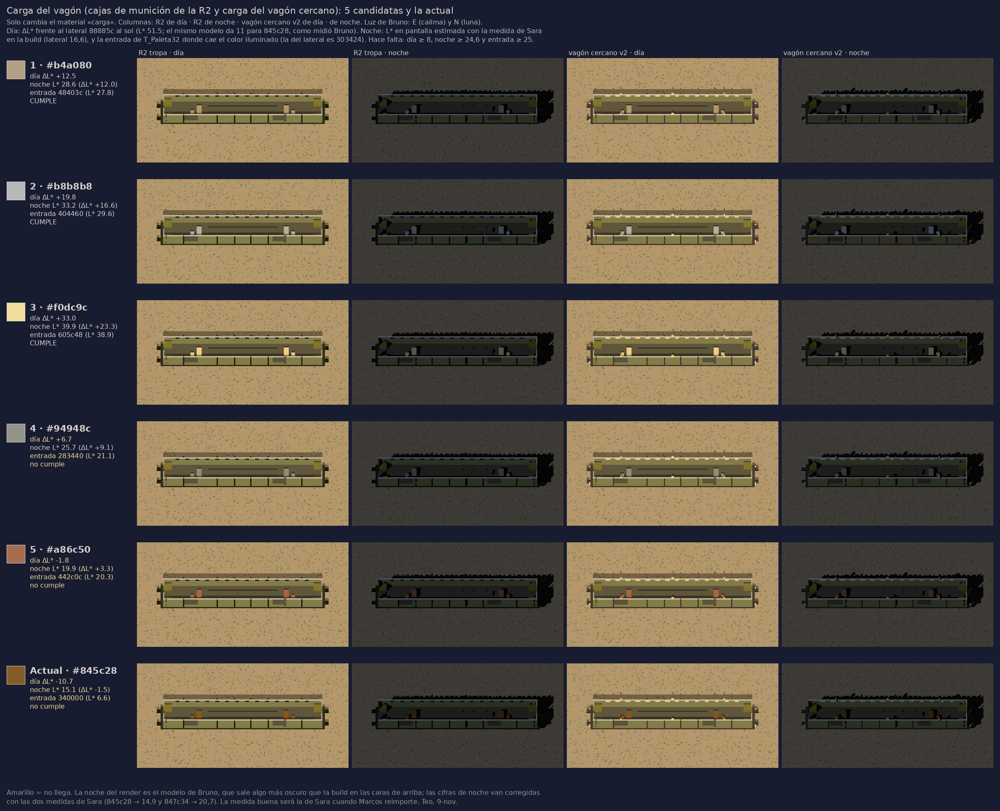

# Carga del vagón de noche: 5 candidatas · Teo, 9-nov

Encargo de Lucía (9-nov). Solo cambia el material «carga» (hoy #845c28): las cajas de munición de la R2 y la carga del vagón cercano v2. **Elige Lucía**, y la elegida va como §6 de IMPORTAR-NOCHE.

| # | Color | Día: ΔL* con el lateral al sol | Noche: L* en pantalla (ΔL* con 16,6) | Entrada de T_Paleta32 de noche | ¿Cumple? |
|---|---|---|---|---|---|
| 1 | b4a080 | +12,5 | 28,6 (+12,0) | 48403c (L* 27,8) | Sí |
| 2 | b8b8b8 | +19,8 | 33,2 (+16,6) | 404460 (L* 29,6) | Sí |
| 3 | f0dc9c | +33,0 | 39,9 (+23,3) | 605c48 (L* 38,9) | Sí |
| 4 | 94948c | +6,7 | 25,7 (+9,1) | 283440 (L* 21,1) | No: de día no llega a 8 y de noche cae en una entrada por debajo de 25 |
| 5 | a86c50 | −1,8 | 19,9 (+3,3) | 442c0c (L* 20,3) | No |
| — | 845c28 (actual) | −10,7 | 15,1 (−1,5) | 340000 | No |

Solo tres colores de la paleta cumplen las tres condiciones: b4a080, b8b8b8 y f0dc9c. Las otras dos candidatas son las más cercanas que no llegan, para que se vea dónde está el límite. El ámbar e08c30 y el d4d0cc también llegarían, pero están reservados.

**Cómo está medido**
- Uso la luz de Bruno (`build_dia_horda.py`): E (calima) de día y N (luna) de noche, por caras: la carga se ve desde arriba y el lateral está de cara a la cámara.
- Día: comparo con el lateral 88885c al sol (L* 51,5). El mismo modelo da −10,7 para 845c28 y −2,4 para 847c34; Bruno midió 11,4 y 3,1 en pantalla.
- Noche: el modelo de Bruno sale algo más oscuro que la build en las caras de arriba. Corrijo la carga con las dos medidas de Sara (845c28 → 14,9 y 847c34 → 20,7; factor 1,28 en Y, igual en las dos) y uso como lateral los 16,6 que midió ella.
- La entrada es el color de la paleta más cercano (distancia en lineal, como `PaletteQuantize.shader`, con mezcla 0,65). La del lateral es 303424.
- Es una estimación. La medida buena será la de Sara cuando Marcos lo reimporte.

**A tener en cuenta**
- b8b8b8 es el color del techo de los coches. En el cercano, la carga se juntaría con el techo.
- f0dc9c es el color de las ventanillas encendidas. De noche, la carga podría leerse como luz.
- b4a080 es el color del suelo apisonado. Eso no molesta, porque la carga va encima del vagón y no en el suelo, y es la que tiene un margen más justo de noche (+4 sobre el mínimo).

— Teo · [retrato](/mnt/project-files/equipo/retrato_teo_64_x4.png)
