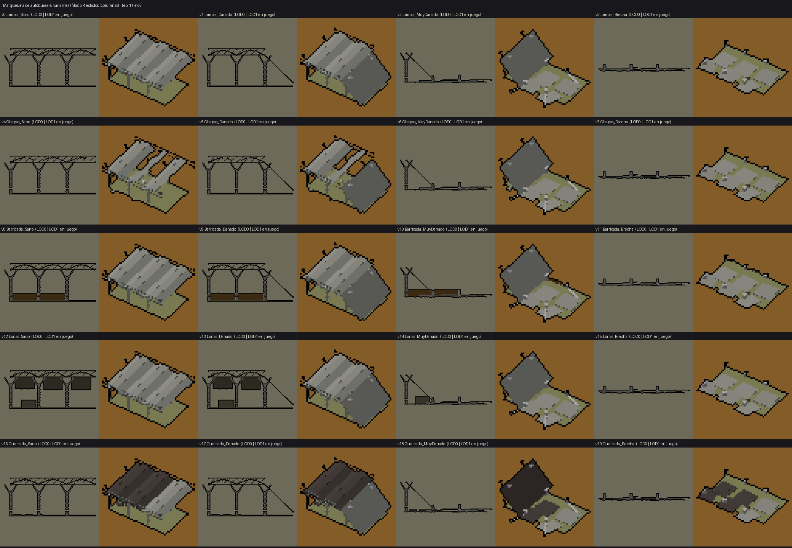
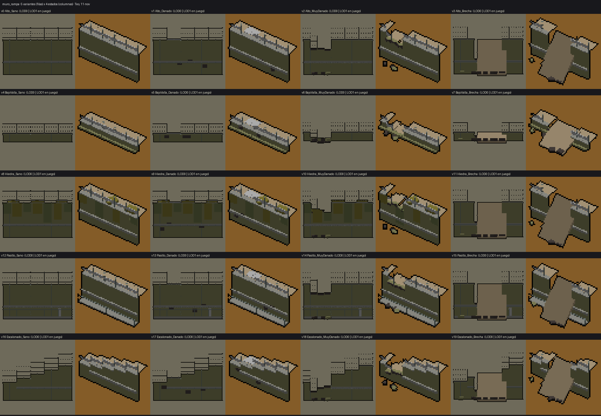

# Kit del cerco de Castellón: marquesina de autobuses y muro de la rampa del túnel (Teo, 11-nov)

Lucía aprobó este alcance el 11-nov. Es para el **nivel de Castellón de después del MVP**, así que **no se integra antes del 19-nov**. Las dos
piezas salen de las fotos reales de Paula (`referencias-reales/castellon/`, mr-mak 1caeaa9): la marquesina de autobuses de la
**CS9** y el muro de la rampa del túnel de las **CS5 y CS8**. Cada pieza tiene 5 variantes × 4 estados de vida, con LOD0 y LOD1 (80 FBX).
Todas usan la misma `T_Paleta32.png` (URP/Lit, `_BaseMap` = paleta) y se exportaron con `--costado 88885c --claro b8b8b8`.
Las medidas son **a ojo de las fotos (SIN VERIFICAR)**. Propongo la carpeta `Resources/Models/Castellon`.

Nombre: `SM_<Pieza>_v<k>_<Variante>_e<n>_<Estado>_LOD<l>`, con los estados igual que en la puerta de vehículos (e0 Sano, e1 Danado,
e2 MuyDanado, e3 Brecha), para elegirlos con `EstadoPuerta(lifeMil)`.

## SM_MarquesinaBus: marquesina de la estación de autobuses (CS9)

**Módulo de 12 m** a lo largo de X y 10 m de fondo. Tiene tres bóvedas de 4 m (la cubierta ondulada de la foto) a 4,5 m en los
pilares, con 0,7 m de flecha. Los pilares en V tienen el fuste trenzado en dos grises y una viga de borde en celosía. Origen en el
suelo, en el centro. **Los módulos se encadenan a lo largo de X**: cada uno lleva los pilares de x −6, −2 y 2, y el de x = 6
lo pone el módulo siguiente. Al final de una fila hace falta un remate (otro módulo o un pilar suelto).

| v | Variante | Qué se ve |
|---|---|---|
| 0 | Limpia | como en la foto |
| 1 | Chapas | huecos en la cubierta y chapas arrancadas en el suelo |
| 2 | Barricada | tablones y sacos entre los pilares de delante (+Y) |
| 3 | Lonas | lonas colgadas del borde de delante y una tienda debajo |
| 4 | Quemada | media cubierta en hollín (48403c) y restos quemados |

Estados: e1, la bóveda de la punta cuelga de un lado; e2, dos bóvedas en el suelo y cuatro pilares caídos; e3, todo en el
suelo (muñones y chapas), sin tapar nada.

## SM_MuroRampa: muro de la trinchera del túnel (CS5 y CS8)

**Módulo de 10 m** a lo largo de X. **El paramento mira a −Y (la vía)** y el terreno queda detrás (+Y), a la altura de la coronación.
Origen en el pie del muro, en el centro. Lleva una banda de canaletas a 1,85 m (la de la CS8), albardilla y valla de malla.

| v | Variante | Qué se ve |
|---|---|---|
| 0 | Alto | trinchera de 5 m (CS8) |
| 1 | BajoValla | 1,2 m con murete y valla, la salida de la CS5 |
| 2 | Hiedra | 5 m con hiedra colgando y matas arriba |
| 3 | Pasillo | 5 m con pasillo de servicio, barandilla y armario de señales |
| 4 | Escalonado | baja de 5 a 2,6 m en el módulo: tramo de transición |

Estados: e1, desconchones y un tramo de valla caído; e2, coronación rota en 3 m, escombro al pie y tierra derramada; e3,
brecha de 4 m hundida hasta 0,8 m, con una rampa de tierra que baja a la vía. **La brecha se puede pasar**: lo que diga la simulación es cosa de Nacho.

Bloques: `marquesina_bus.py` y `muro_rampa.py` del skill modelado-3d (TBD, rama `claude/modelado-3d-skill`). Las capturas
`captura_marquesina_v0.png` y `captura_muro_v0.png` comparan con la foto real.

## Tabla de colores por celda (leída de los UV, colores_uv.py)

Es la primera entrega de estas dos piezas, así que no hay entrega anterior con la que comparar. Todas las celdas son las
esperadas de cada bloque: en la marquesina 94948c, 6c7874, b8b8b8, 88885c, 845c28, 605c48 y 48403c; en el muro 88885c, 6c7874,
94948c, b8b8b8, b4a080, 70784c, 847c34 y 48403c. Ninguna cae en la banda ni en los colores reservados (283440, 303424, 1c200c,
543820, 442c0c, 50541c, 982420, e08c30, d4d0cc). El único oscuro es 48403c, que la D-N80 permite.

| Modelo | LOD | Celda y vértices |
|---|---|---|
| SM_MarquesinaBus_v0_Limpia_e0_Sano | LOD0 | b8b8b8 2328, 94948c 2064, 6c7874 864, 88885c 48 |
| SM_MarquesinaBus_v0_Limpia_e0_Sano | LOD1 | b8b8b8 576, 6c7874 288, 94948c 216, 88885c 24 |
| SM_MarquesinaBus_v0_Limpia_e1_Danado | LOD0 | b8b8b8 2328, 94948c 1944, 6c7874 576, 88885c 48 |
| SM_MarquesinaBus_v0_Limpia_e1_Danado | LOD1 | b8b8b8 576, 6c7874 192, 94948c 168, 88885c 24 |
| SM_MarquesinaBus_v0_Limpia_e2_MuyDanado | LOD0 | b8b8b8 1144, 94948c 712, 88885c 48, 6c7874 48, 48403c 48 |
| SM_MarquesinaBus_v0_Limpia_e2_MuyDanado | LOD1 | b8b8b8 480, 94948c 120, 88885c 24, 6c7874 24, 48403c 24 |
| SM_MarquesinaBus_v0_Limpia_e3_Brecha | LOD0 | b8b8b8 552, 94948c 216, 88885c 48, 6c7874 48, 48403c 48 |
| SM_MarquesinaBus_v0_Limpia_e3_Brecha | LOD1 | b8b8b8 288, 94948c 144, 88885c 24, 48403c 24, 6c7874 24 |
| SM_MarquesinaBus_v1_Chapas_e0_Sano | LOD0 | b8b8b8 2328, 94948c 1968, 6c7874 864, 88885c 48 |
| SM_MarquesinaBus_v1_Chapas_e0_Sano | LOD1 | b8b8b8 576, 6c7874 288, 94948c 192, 88885c 24 |
| SM_MarquesinaBus_v1_Chapas_e1_Danado | LOD0 | b8b8b8 2328, 94948c 1920, 6c7874 576, 88885c 48 |
| SM_MarquesinaBus_v1_Chapas_e1_Danado | LOD1 | b8b8b8 576, 6c7874 192, 94948c 168, 88885c 24 |
| SM_MarquesinaBus_v1_Chapas_e2_MuyDanado | LOD0 | b8b8b8 1144, 94948c 784, 88885c 48, 6c7874 48, 48403c 48 |
| SM_MarquesinaBus_v1_Chapas_e2_MuyDanado | LOD1 | b8b8b8 480, 94948c 168, 88885c 24, 6c7874 24, 48403c 24 |
| SM_MarquesinaBus_v1_Chapas_e3_Brecha | LOD0 | b8b8b8 552, 94948c 288, 88885c 48, 6c7874 48, 48403c 48 |
| SM_MarquesinaBus_v1_Chapas_e3_Brecha | LOD1 | b8b8b8 288, 94948c 192, 88885c 24, 6c7874 24, 48403c 24 |
| SM_MarquesinaBus_v2_Barricada_e0_Sano | LOD0 | b8b8b8 2328, 94948c 2064, 6c7874 864, 605c48 192, 845c28 144, 88885c 48 |
| SM_MarquesinaBus_v2_Barricada_e0_Sano | LOD1 | b8b8b8 576, 6c7874 288, 94948c 216, 845c28 96, 605c48 96, 88885c 24 |
| SM_MarquesinaBus_v2_Barricada_e1_Danado | LOD0 | b8b8b8 2328, 94948c 1944, 6c7874 576, 605c48 192, 845c28 144, 88885c 48 |
| SM_MarquesinaBus_v2_Barricada_e1_Danado | LOD1 | b8b8b8 576, 6c7874 192, 94948c 168, 845c28 96, 605c48 96, 88885c 24 |
| SM_MarquesinaBus_v2_Barricada_e2_MuyDanado | LOD0 | b8b8b8 1144, 94948c 712, 605c48 192, 845c28 144, 88885c 48, 6c7874 48, 48403c 48 |
| SM_MarquesinaBus_v2_Barricada_e2_MuyDanado | LOD1 | b8b8b8 480, 94948c 120, 845c28 96, 605c48 96, 88885c 24, 6c7874 24, 48403c 24 |
| SM_MarquesinaBus_v2_Barricada_e3_Brecha | LOD0 | b8b8b8 552, 94948c 216, 605c48 192, 88885c 48, 6c7874 48, 48403c 48 |
| SM_MarquesinaBus_v2_Barricada_e3_Brecha | LOD1 | b8b8b8 288, 94948c 144, 605c48 96, 88885c 24, 6c7874 24, 48403c 24 |
| SM_MarquesinaBus_v3_Lonas_e0_Sano | LOD0 | b8b8b8 2328, 94948c 2064, 6c7874 864, 605c48 90, 88885c 48 |
| SM_MarquesinaBus_v3_Lonas_e0_Sano | LOD1 | b8b8b8 576, 6c7874 288, 94948c 216, 605c48 72, 88885c 24 |
| SM_MarquesinaBus_v3_Lonas_e1_Danado | LOD0 | b8b8b8 2328, 94948c 1944, 6c7874 576, 605c48 66, 88885c 48 |
| SM_MarquesinaBus_v3_Lonas_e1_Danado | LOD1 | b8b8b8 576, 6c7874 192, 94948c 168, 605c48 48, 88885c 24 |
| SM_MarquesinaBus_v3_Lonas_e2_MuyDanado | LOD0 | b8b8b8 1144, 94948c 712, 88885c 48, 6c7874 48, 48403c 48, 605c48 18 |
| SM_MarquesinaBus_v3_Lonas_e2_MuyDanado | LOD1 | b8b8b8 480, 94948c 120, 88885c 24, 6c7874 24, 48403c 24 |
| SM_MarquesinaBus_v3_Lonas_e3_Brecha | LOD0 | b8b8b8 552, 94948c 216, 88885c 48, 6c7874 48, 48403c 48 |
| SM_MarquesinaBus_v3_Lonas_e3_Brecha | LOD1 | b8b8b8 288, 94948c 144, 88885c 24, 48403c 24, 6c7874 24 |
| SM_MarquesinaBus_v4_Quemada_e0_Sano | LOD0 | b8b8b8 2328, 94948c 1848, 6c7874 864, 48403c 288, 88885c 48 |
| SM_MarquesinaBus_v4_Quemada_e0_Sano | LOD1 | b8b8b8 576, 6c7874 288, 48403c 192, 94948c 72, 88885c 24 |
| SM_MarquesinaBus_v4_Quemada_e1_Danado | LOD0 | b8b8b8 2328, 94948c 1728, 6c7874 576, 48403c 288, 88885c 48 |
| SM_MarquesinaBus_v4_Quemada_e1_Danado | LOD1 | b8b8b8 576, 48403c 192, 6c7874 192, 88885c 24, 94948c 24 |
| SM_MarquesinaBus_v4_Quemada_e2_MuyDanado | LOD0 | b8b8b8 1144, 94948c 616, 48403c 216, 88885c 48, 6c7874 48 |
| SM_MarquesinaBus_v4_Quemada_e2_MuyDanado | LOD1 | b8b8b8 480, 48403c 144, 94948c 48, 88885c 24, 6c7874 24 |
| SM_MarquesinaBus_v4_Quemada_e3_Brecha | LOD0 | b8b8b8 552, 48403c 264, 94948c 72, 88885c 48, 6c7874 48 |
| SM_MarquesinaBus_v4_Quemada_e3_Brecha | LOD1 | b8b8b8 288, 48403c 168, 94948c 48, 88885c 24, 6c7874 24 |
| SM_MuroRampa_v0_Alto_e0_Sano | LOD0 | b8b8b8 720, 94948c 480, 6c7874 456, 88885c 240, b4a080 240 |
| SM_MuroRampa_v0_Alto_e0_Sano | LOD1 | 94948c 480, 88885c 240, b4a080 240, b8b8b8 240, 6c7874 120 |
| SM_MuroRampa_v0_Alto_e1_Danado | LOD0 | b8b8b8 624, 94948c 480, 6c7874 432, 88885c 240, b4a080 240, 48403c 72 |
| SM_MuroRampa_v0_Alto_e1_Danado | LOD1 | 94948c 480, 88885c 240, b4a080 240, b8b8b8 240, 6c7874 96, 48403c 48 |
| SM_MuroRampa_v0_Alto_e2_MuyDanado | LOD0 | b8b8b8 576, 6c7874 432, 94948c 408, 88885c 288, b4a080 240, 48403c 144 |
| SM_MuroRampa_v0_Alto_e2_MuyDanado | LOD1 | 94948c 408, 88885c 264, b4a080 240, b8b8b8 192, 48403c 120, 6c7874 96 |
| SM_MuroRampa_v0_Alto_e3_Brecha | LOD0 | 6c7874 360, b8b8b8 360, 94948c 336, 88885c 288, b4a080 264, 48403c 264 |
| SM_MuroRampa_v0_Alto_e3_Brecha | LOD1 | 94948c 336, 88885c 264, b4a080 264, 48403c 192, b8b8b8 120, 6c7874 72 |
| SM_MuroRampa_v1_BajoValla_e0_Sano | LOD0 | b8b8b8 720, 88885c 480, b4a080 240, 94948c 240, 6c7874 216 |
| SM_MuroRampa_v1_BajoValla_e0_Sano | LOD1 | 88885c 360, b4a080 240, 94948c 240, b8b8b8 240, 6c7874 120 |
| SM_MuroRampa_v1_BajoValla_e1_Danado | LOD0 | b8b8b8 624, 88885c 480, b4a080 240, 94948c 240, 6c7874 192, 48403c 72 |
| SM_MuroRampa_v1_BajoValla_e1_Danado | LOD1 | 88885c 360, b4a080 240, 94948c 240, b8b8b8 240, 6c7874 96, 48403c 48 |
| SM_MuroRampa_v1_BajoValla_e2_MuyDanado | LOD0 | b8b8b8 576, 88885c 528, b4a080 240, 94948c 168, 6c7874 168, 48403c 144 |
| SM_MuroRampa_v1_BajoValla_e2_MuyDanado | LOD1 | 88885c 384, b4a080 240, b8b8b8 192, 94948c 168, 48403c 120, 6c7874 96 |
| SM_MuroRampa_v1_BajoValla_e3_Brecha | LOD0 | 88885c 528, b8b8b8 360, b4a080 264, 48403c 264, 94948c 144, 6c7874 120 |
| SM_MuroRampa_v1_BajoValla_e3_Brecha | LOD1 | 88885c 384, b4a080 264, 48403c 192, 94948c 144, b8b8b8 120, 6c7874 72 |
| SM_MuroRampa_v2_Hiedra_e0_Sano | LOD0 | b8b8b8 720, 94948c 480, 6c7874 456, 88885c 240, b4a080 240, 847c34 144, 70784c 96 |
| SM_MuroRampa_v2_Hiedra_e0_Sano | LOD1 | 94948c 480, 88885c 240, b4a080 240, b8b8b8 240, 6c7874 120, 847c34 96, 70784c 48 |
| SM_MuroRampa_v2_Hiedra_e1_Danado | LOD0 | b8b8b8 624, 94948c 480, 6c7874 432, 88885c 240, b4a080 240, 847c34 144, 70784c 96, 48403c 72 |
| SM_MuroRampa_v2_Hiedra_e1_Danado | LOD1 | 94948c 480, 88885c 240, b4a080 240, b8b8b8 240, 6c7874 96, 847c34 96, 70784c 48, 48403c 48 |
| SM_MuroRampa_v2_Hiedra_e2_MuyDanado | LOD0 | b8b8b8 576, 6c7874 432, 94948c 408, 88885c 288, b4a080 240, 48403c 144, 847c34 144, 70784c 96 |
| SM_MuroRampa_v2_Hiedra_e2_MuyDanado | LOD1 | 94948c 408, 88885c 264, b4a080 240, b8b8b8 192, 48403c 120, 6c7874 96, 847c34 96, 70784c 48 |
| SM_MuroRampa_v2_Hiedra_e3_Brecha | LOD0 | 6c7874 360, b8b8b8 360, 94948c 336, 88885c 288, b4a080 264, 48403c 264 |
| SM_MuroRampa_v2_Hiedra_e3_Brecha | LOD1 | 94948c 336, 88885c 264, b4a080 264, 48403c 192, b8b8b8 120, 6c7874 72 |
| SM_MuroRampa_v3_Pasillo_e0_Sano | LOD0 | b8b8b8 744, 6c7874 624, 94948c 504, 88885c 240, b4a080 240 |
| SM_MuroRampa_v3_Pasillo_e0_Sano | LOD1 | 94948c 504, 88885c 240, b4a080 240, b8b8b8 240, 6c7874 216 |
| SM_MuroRampa_v3_Pasillo_e1_Danado | LOD0 | b8b8b8 648, 6c7874 600, 94948c 504, 88885c 240, b4a080 240, 48403c 72 |
| SM_MuroRampa_v3_Pasillo_e1_Danado | LOD1 | 94948c 504, 88885c 240, b4a080 240, b8b8b8 240, 6c7874 192, 48403c 48 |
| SM_MuroRampa_v3_Pasillo_e2_MuyDanado | LOD0 | 6c7874 600, b8b8b8 600, 94948c 432, 88885c 288, b4a080 240, 48403c 144 |
| SM_MuroRampa_v3_Pasillo_e2_MuyDanado | LOD1 | 94948c 432, 88885c 264, b4a080 240, 6c7874 192, b8b8b8 192, 48403c 120 |
| SM_MuroRampa_v3_Pasillo_e3_Brecha | LOD0 | 6c7874 528, b8b8b8 384, 94948c 360, 88885c 288, b4a080 264, 48403c 264 |
| SM_MuroRampa_v3_Pasillo_e3_Brecha | LOD1 | 94948c 360, 88885c 264, b4a080 264, 48403c 192, 6c7874 168, b8b8b8 120 |
| SM_MuroRampa_v4_Escalonado_e0_Sano | LOD0 | b8b8b8 720, 94948c 432, 6c7874 408, 88885c 240, b4a080 240 |
| SM_MuroRampa_v4_Escalonado_e0_Sano | LOD1 | 94948c 432, 88885c 240, b4a080 240, b8b8b8 240, 6c7874 120 |
| SM_MuroRampa_v4_Escalonado_e1_Danado | LOD0 | b8b8b8 624, 94948c 432, 6c7874 384, 88885c 240, b4a080 240, 48403c 72 |
| SM_MuroRampa_v4_Escalonado_e1_Danado | LOD1 | 94948c 432, 88885c 240, b4a080 240, b8b8b8 240, 6c7874 96, 48403c 48 |
| SM_MuroRampa_v4_Escalonado_e2_MuyDanado | LOD0 | b8b8b8 576, 6c7874 336, 94948c 312, 88885c 288, b4a080 240, 48403c 144 |
| SM_MuroRampa_v4_Escalonado_e2_MuyDanado | LOD1 | 94948c 312, 88885c 264, b4a080 240, b8b8b8 192, 48403c 120, 6c7874 96 |
| SM_MuroRampa_v4_Escalonado_e3_Brecha | LOD0 | b8b8b8 360, 88885c 288, b4a080 264, 6c7874 264, 48403c 264, 94948c 240 |
| SM_MuroRampa_v4_Escalonado_e3_Brecha | LOD1 | 88885c 264, b4a080 264, 94948c 240, 48403c 192, b8b8b8 120, 6c7874 72 |
