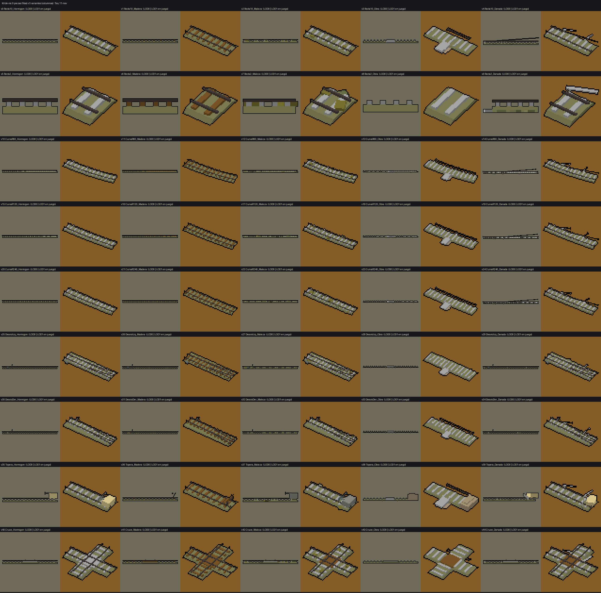
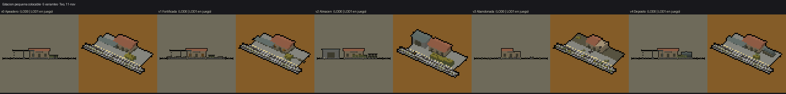
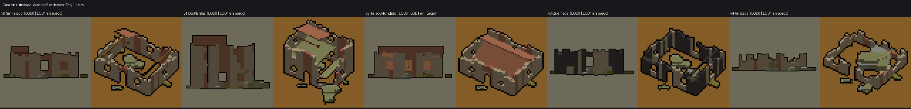

# Hito 1 del núcleo v2: kit de vía para trazar, estación pequeña y casas en ruinas (Teo, 11-nov)

Encargo de Lucía del 11-11 (`docs/hito1-reparto.md`): es el arte de la red construible que monta Iker. Son 55 modelos con LOD0
y LOD1 (110 FBX) y una sola `T_Paleta32.png` (URP/Lit, `_BaseMap` = paleta), exportados con `--costado 88885c --claro b8b8b8`.
Las medidas son **típicas, de memoria (SIN VERIFICAR)**. Propongo la carpeta `Resources/Models/Red`.

## 1. Kit de vía (`SM_Via_<Pieza>_v<k>_<Variante>`)

**Cómo encajan las piezas.** Todas tienen el **origen en el conector A**, en el eje de la vía y a ras de suelo, y salen hacia +X.
En Unity eso es +X con la Y arriba. La Y de Blender pasa a ser −Z en Unity, así que **una curva «a la izquierda» (+Y en Blender)
gira hacia −Z en Unity**: compruébalo con la primera pieza. Para ir a la derecha se usa la misma curva recorrida al revés, girada
180° y puesta en su conector B. El desvío sí trae izquierda y derecha por separado.

Datos de la vía:
- Ancho ibérico de 1,668 m.
- Banqueta de balasto de 3,6 m de base, 2,8 m de coronación y 0,35 m de alto.
- Traviesas de 2,6 m, cada 0,6 m en el LOD0 y cada 1,2 m en el LOD1.
- **Cabeza del carril a 0,72 m sobre el suelo**: a esa altura va la rueda del tren.

| Pieza | Conector B (x; y; rumbo en grados, en Blender) | Notas |
|---|---|---|
| Recta10 | (10; 0; 0) | la pieza base |
| Recta2 | (2,5; 0; 0) | para ajustar |
| CurvaR60 | (15,529; 2,045; 15) | 6 piezas = 90° |
| CurvaR120 | (15,663; 1,027; 7,5) | 12 piezas = 90° |
| CurvaR240 | (15,697; 0,514; 3,75) | 24 piezas = 90° |
| DesvioIzq | recta (15,663; 0; 0) y desviada (15,663; 1,027; 7,5) | sale con R 120. Motor del cambio en el lado contrario |
| DesvioDer | recta (15,663; 0; 0) y desviada (15,663; −1,027; −7,5) | espejo del anterior |
| Topera | ninguno: la vía acaba en x = 10 | la topera ocupa de x 7,6 a 10 |
| Cruce | B (10; 0; 0); la otra vía, de C (5; −5; 90) a D (5; 5; 90) | cruce de dos vías a 90° en x = 5 |

Desvío + Recta10 + 2 Recta2 + CurvaR120 al revés = **dos vías paralelas a 4,01 m entre ejes**.

**Leí «cruce a nivel» como el cruce de dos vías** (diamante). El paso a nivel con una carretera ya existe en `paso_nivel.py`, con
barreras animables, y lo adapto cuando lleguen las carreteras.

| v | Variante | Qué se ve |
|---|---|---|
| 0 | Hormigon | vía nueva, traviesas de hormigón |
| 1 | Madera | traviesas viejas de madera, algunas torcidas |
| 2 | Maleza | maleza entre las traviesas y en la banqueta |
| 3 | Obra | en construcción: balasto y traviesas sin carriles, con los carriles tirados al lado y un acopio de traviesas |
| 4 | Danada | un carril levantado, traviesas sueltas y balasto por el suelo |

La v3 (Obra) puede servir de **vía a medio tender** mientras trabaja la cuadrilla. La v4 (Danada) puede ser la **vía cortada** por la horda.

## 2. Estación pequeña colocable (`SM_EstacionH1_v<k>_<Variante>`)

Es una pieza más del kit, con el **mismo conector**: origen en A (eje, suelo) y conector B en (30; 0). Lleva su propio tramo recto
de 30 m, así que ocupa el lugar de tres Recta10. Tiene:
- Andén lateral de 24 × 4 m a +Y (borde a 1,9 m del eje, 0,68 m de alto).
- Edificio de 8 × 5 m detrás.
- Pilas de cajas de munición en el andén: el almacén de la estación.

Ocupa de y −1,8 a 12,4.

| v | Variante | Qué se ve |
|---|---|---|
| 0 | Apeadero | marquesina y 12 cajas |
| 1 | Fortificada | sacos en el andén y ventanas tapiadas |
| 2 | Almacen | nave de chapa y 38 cajas: un buen puesto avanzado |
| 3 | Abandonada | tejado roto, escombro y maleza, sin cajas: una estación por recuperar |
| 4 | Deposito | tanque de gasoil y bidones, para cuando llegue el gasoil |

## 3. Casa en ruinas del caserío (`SM_CasaRuina_v<k>_<Variante>`)

Casa de huerta de muros de carga de 9 × 7 m, de una planta (3,4 m) y de dos en la v1 (6,4 m). La fachada con la puerta mira a −Y.
Origen en el suelo, en el centro de la planta. Por dentro queda sitio para el depósito de material que deja el caserío al
limpiarlo, que pone el juego.

| v | Variante | Qué se ve |
|---|---|---|
| 0 | SinTejado | muros enteros con el remate roto, vigas y un trozo de tejado |
| 1 | DosPlantas | la esquina del sureste caída, con el forjado partido |
| 2 | TejadoHundido | el faldón del sur hundido hacia dentro |
| 3 | Quemada | hollín en los muros y vigas carbonizadas |
| 4 | Arrasada | muros bajos y un gran montón de escombro |

Bloques: `via_trazado.py`, `estacion_h1.py` y `casa_ruina.py` del skill modelado-3d (TBD, rama `claude/modelado-3d-skill`).
Hay capturas con la foto de referencia de Paula para el desvío, la estación y la casa (`captura_*.png`).

## Tabla de colores por celda (leída de los UV, colores_uv.py)

Es la primera entrega de estas piezas, así que no hay entrega anterior con la que comparar. Todas las celdas son las esperadas:
- **Vía:** 88885c, b8b8b8, 845c28, 48403c, 6c7874, f0dc9c, 94948c, 70784c, 847c34 y b4a080.
- **Estación:** las de la vía, más 605c48 y a86c50.
- **Casa:** b4a080, a86c50, 7c3c18, 845c28, 48403c, 94948c, 88885c, 70784c y 847c34.

Ninguna cae en la banda ni en los colores reservados (283440, 303424, 1c200c, 543820, 442c0c, 50541c, 982420, e08c30, d4d0cc).
La cal d4d0cc, que es la de la selección, no se usa. El único oscuro es 48403c, que la D-N80 permite.

| Modelo | LOD | Celda y vértices |
|---|---|---|
| SM_CasaRuina_v0_SinTejado | LOD0 | b4a080 1320, a86c50 360, 88885c 168, 845c28 96, 94948c 96, 847c34 72, 70784c 48, 7c3c18 24 |
| SM_CasaRuina_v0_SinTejado | LOD1 | b4a080 1320, a86c50 360, 88885c 120, 845c28 48, 94948c 48, 847c34 48, 7c3c18 24, 70784c 24 |
| SM_CasaRuina_v1_DosPlantas | LOD0 | b4a080 1464, a86c50 432, 88885c 312, 94948c 168, 847c34 72, 70784c 48, 7c3c18 24 |
| SM_CasaRuina_v1_DosPlantas | LOD1 | b4a080 1464, a86c50 432, 88885c 240, 94948c 72, 847c34 48, 7c3c18 24, 70784c 24 |
| SM_CasaRuina_v2_TejadoHundido | LOD0 | b4a080 1344, a86c50 384, 88885c 168, 94948c 96, 845c28 72, 847c34 72, 70784c 48 |
| SM_CasaRuina_v2_TejadoHundido | LOD1 | b4a080 1344, a86c50 384, 88885c 120, 94948c 48, 847c34 48, 70784c 24 |
| SM_CasaRuina_v3_Quemada | LOD0 | 48403c 1104, b4a080 648, 88885c 264, 94948c 168, 847c34 72, 70784c 48 |
| SM_CasaRuina_v3_Quemada | LOD1 | 48403c 1056, b4a080 648, 88885c 192, 94948c 72, 847c34 48, 70784c 24 |
| SM_CasaRuina_v4_Arrasada | LOD0 | b4a080 1128, 88885c 312, a86c50 264, 94948c 192, 845c28 72, 847c34 72, 70784c 48 |
| SM_CasaRuina_v4_Arrasada | LOD1 | b4a080 1128, a86c50 264, 88885c 192, 94948c 96, 845c28 48, 847c34 48, 70784c 24 |
| SM_EstacionH1_v0_Apeadero | LOD0 | b8b8b8 1200, 48403c 400, 70784c 288, 88885c 200, 847c34 144, 605c48 120, 6c7874 96, 94948c 72, f0dc9c 24, b4a080 24, a86c50 18 |
| SM_EstacionH1_v0_Apeadero | LOD1 | b8b8b8 600, 48403c 400, 70784c 288, 88885c 200, 847c34 144, 605c48 96, 6c7874 72, 94948c 48, f0dc9c 24, b4a080 24, a86c50 18 |
| SM_EstacionH1_v1_Fortificada | LOD0 | b8b8b8 1200, 605c48 576, 48403c 400, 88885c 200, 70784c 192, 6c7874 96, 847c34 96, 94948c 72, 845c28 48, f0dc9c 24, b4a080 24, a86c50 18 |
| SM_EstacionH1_v1_Fortificada | LOD1 | b8b8b8 600, 48403c 400, 605c48 312, 88885c 200, 70784c 192, 847c34 96, 6c7874 72, 94948c 48, 845c28 48, f0dc9c 24, b4a080 24, a86c50 18 |
| SM_EstacionH1_v2_Almacen | LOD0 | b8b8b8 1200, 70784c 912, 48403c 400, 847c34 384, 88885c 200, 605c48 144, 94948c 96, f0dc9c 24, b4a080 24, a86c50 18, 6c7874 18 |
| SM_EstacionH1_v2_Almacen | LOD1 | 70784c 912, b8b8b8 600, 48403c 400, 847c34 384, 88885c 200, 605c48 120, 94948c 72, f0dc9c 24, b4a080 24, a86c50 18, 6c7874 18 |
| SM_EstacionH1_v3_Abandonada | LOD0 | b8b8b8 1200, 48403c 496, 847c34 288, 88885c 272, 70784c 264, 605c48 144, 94948c 48, f0dc9c 24, b4a080 24, 845c28 24, a86c50 18 |
| SM_EstacionH1_v3_Abandonada | LOD1 | b8b8b8 600, 48403c 448, 88885c 248, 847c34 168, 70784c 144, 605c48 120, 94948c 24, f0dc9c 24, b4a080 24, 845c28 24, a86c50 18 |
| SM_EstacionH1_v4_Deposito | LOD0 | b8b8b8 1200, 70784c 624, 48403c 400, 6c7874 204, 88885c 200, 605c48 144, 94948c 96, 847c34 48, f0dc9c 24, b4a080 24, a86c50 18 |
| SM_EstacionH1_v4_Deposito | LOD1 | b8b8b8 600, 48403c 400, 70784c 240, 88885c 200, 6c7874 140, 605c48 120, 94948c 48, 847c34 48, f0dc9c 24, b4a080 24, a86c50 18 |
| SM_Via_Cruce_v0_Hormigon | LOD0 | b8b8b8 552, 48403c 288, 88885c 144 |
| SM_Via_Cruce_v0_Hormigon | LOD1 | b8b8b8 312, 48403c 288, 88885c 144 |
| SM_Via_Cruce_v1_Madera | LOD0 | 845c28 552, 48403c 288, 88885c 144 |
| SM_Via_Cruce_v1_Madera | LOD1 | 845c28 312, 48403c 288, 88885c 144 |
| SM_Via_Cruce_v2_Maleza | LOD0 | b8b8b8 528, 48403c 288, 88885c 144, 847c34 144, 70784c 144, 845c28 24 |
| SM_Via_Cruce_v2_Maleza | LOD1 | b8b8b8 288, 48403c 288, 88885c 144, 847c34 96, 70784c 48, 845c28 24 |
| SM_Via_Cruce_v3_Obra | LOD0 | b8b8b8 528, 88885c 144, 48403c 80, 845c28 24 |
| SM_Via_Cruce_v3_Obra | LOD1 | b8b8b8 288, 88885c 144, 48403c 80, 845c28 24 |
| SM_Via_Cruce_v4_Danada | LOD0 | b8b8b8 576, 48403c 288, 88885c 216, 845c28 24 |
| SM_Via_Cruce_v4_Danada | LOD1 | b8b8b8 336, 48403c 288, 88885c 144, 845c28 24 |
| SM_Via_CurvaR120_v0_Hormigon | LOD0 | b8b8b8 624, 48403c 432, 88885c 216 |
| SM_Via_CurvaR120_v0_Hormigon | LOD1 | 48403c 432, b8b8b8 312, 88885c 216 |
| SM_Via_CurvaR120_v1_Madera | LOD0 | 845c28 624, 48403c 432, 88885c 216 |
| SM_Via_CurvaR120_v1_Madera | LOD1 | 48403c 432, 845c28 312, 88885c 216 |
| SM_Via_CurvaR120_v2_Maleza | LOD0 | b8b8b8 624, 48403c 432, 88885c 216, 847c34 120, 70784c 96 |
| SM_Via_CurvaR120_v2_Maleza | LOD1 | 48403c 432, b8b8b8 312, 88885c 216, 847c34 72, 70784c 48 |
| SM_Via_CurvaR120_v3_Obra | LOD0 | b8b8b8 696, 48403c 368, 88885c 216, b4a080 24 |
| SM_Via_CurvaR120_v3_Obra | LOD1 | b8b8b8 384, 48403c 368, 88885c 216, b4a080 24 |
| SM_Via_CurvaR120_v4_Danada | LOD0 | b8b8b8 672, 48403c 344, 88885c 288 |
| SM_Via_CurvaR120_v4_Danada | LOD1 | b8b8b8 360, 48403c 344, 88885c 216 |
| SM_Via_CurvaR240_v0_Hormigon | LOD0 | b8b8b8 624, 48403c 432, 88885c 216 |
| SM_Via_CurvaR240_v0_Hormigon | LOD1 | 48403c 432, b8b8b8 312, 88885c 216 |
| SM_Via_CurvaR240_v1_Madera | LOD0 | 845c28 624, 48403c 432, 88885c 216 |
| SM_Via_CurvaR240_v1_Madera | LOD1 | 48403c 432, 845c28 312, 88885c 216 |
| SM_Via_CurvaR240_v2_Maleza | LOD0 | b8b8b8 624, 48403c 432, 88885c 216, 847c34 120, 70784c 96 |
| SM_Via_CurvaR240_v2_Maleza | LOD1 | 48403c 432, b8b8b8 312, 88885c 216, 847c34 72, 70784c 48 |
| SM_Via_CurvaR240_v3_Obra | LOD0 | b8b8b8 696, 48403c 368, 88885c 216, b4a080 24 |
| SM_Via_CurvaR240_v3_Obra | LOD1 | b8b8b8 384, 48403c 368, 88885c 216, b4a080 24 |
| SM_Via_CurvaR240_v4_Danada | LOD0 | b8b8b8 672, 48403c 344, 88885c 288 |
| SM_Via_CurvaR240_v4_Danada | LOD1 | b8b8b8 360, 48403c 344, 88885c 216 |
| SM_Via_CurvaR60_v0_Hormigon | LOD0 | b8b8b8 624, 48403c 432, 88885c 216 |
| SM_Via_CurvaR60_v0_Hormigon | LOD1 | 48403c 432, b8b8b8 312, 88885c 216 |
| SM_Via_CurvaR60_v1_Madera | LOD0 | 845c28 624, 48403c 432, 88885c 216 |
| SM_Via_CurvaR60_v1_Madera | LOD1 | 48403c 432, 845c28 312, 88885c 216 |
| SM_Via_CurvaR60_v2_Maleza | LOD0 | b8b8b8 624, 48403c 432, 88885c 216, 847c34 120, 70784c 96 |
| SM_Via_CurvaR60_v2_Maleza | LOD1 | 48403c 432, b8b8b8 312, 88885c 216, 847c34 72, 70784c 48 |
| SM_Via_CurvaR60_v3_Obra | LOD0 | b8b8b8 696, 48403c 368, 88885c 216, b4a080 24 |
| SM_Via_CurvaR60_v3_Obra | LOD1 | b8b8b8 384, 48403c 368, 88885c 216, b4a080 24 |
| SM_Via_CurvaR60_v4_Danada | LOD0 | b8b8b8 672, 48403c 344, 88885c 288 |
| SM_Via_CurvaR60_v4_Danada | LOD1 | b8b8b8 360, 48403c 344, 88885c 216 |
| SM_Via_DesvioDer_v0_Hormigon | LOD0 | b8b8b8 624, 48403c 560, 88885c 120, 6c7874 72, f0dc9c 24 |
| SM_Via_DesvioDer_v0_Hormigon | LOD1 | 48403c 560, b8b8b8 312, 88885c 120, 6c7874 48 |
| SM_Via_DesvioDer_v1_Madera | LOD0 | 845c28 624, 48403c 560, 88885c 120, 6c7874 72, f0dc9c 24 |
| SM_Via_DesvioDer_v1_Madera | LOD1 | 48403c 560, 845c28 312, 88885c 120, 6c7874 48 |
| SM_Via_DesvioDer_v2_Maleza | LOD0 | b8b8b8 624, 48403c 560, 88885c 120, 847c34 120, 70784c 96, 6c7874 72, f0dc9c 24 |
| SM_Via_DesvioDer_v2_Maleza | LOD1 | 48403c 560, b8b8b8 312, 88885c 120, 847c34 72, 6c7874 48, 70784c 48 |
| SM_Via_DesvioDer_v3_Obra | LOD0 | b8b8b8 696, 48403c 176, 88885c 120, b4a080 24 |
| SM_Via_DesvioDer_v3_Obra | LOD1 | b8b8b8 384, 48403c 176, 88885c 120, b4a080 24 |
| SM_Via_DesvioDer_v4_Danada | LOD0 | b8b8b8 672, 48403c 560, 88885c 192, 6c7874 72, f0dc9c 24 |
| SM_Via_DesvioDer_v4_Danada | LOD1 | 48403c 560, b8b8b8 360, 88885c 120, 6c7874 48 |
| SM_Via_DesvioIzq_v0_Hormigon | LOD0 | b8b8b8 624, 48403c 560, 88885c 120, 6c7874 72, f0dc9c 24 |
| SM_Via_DesvioIzq_v0_Hormigon | LOD1 | 48403c 560, b8b8b8 312, 88885c 120, 6c7874 48 |
| SM_Via_DesvioIzq_v1_Madera | LOD0 | 845c28 624, 48403c 560, 88885c 120, 6c7874 72, f0dc9c 24 |
| SM_Via_DesvioIzq_v1_Madera | LOD1 | 48403c 560, 845c28 312, 88885c 120, 6c7874 48 |
| SM_Via_DesvioIzq_v2_Maleza | LOD0 | b8b8b8 624, 48403c 560, 88885c 120, 847c34 120, 70784c 96, 6c7874 72, f0dc9c 24 |
| SM_Via_DesvioIzq_v2_Maleza | LOD1 | 48403c 560, b8b8b8 312, 88885c 120, 847c34 72, 6c7874 48, 70784c 48 |
| SM_Via_DesvioIzq_v3_Obra | LOD0 | b8b8b8 696, 48403c 176, 88885c 120, b4a080 24 |
| SM_Via_DesvioIzq_v3_Obra | LOD1 | b8b8b8 384, 48403c 176, 88885c 120, b4a080 24 |
| SM_Via_DesvioIzq_v4_Danada | LOD0 | b8b8b8 672, 48403c 560, 88885c 192, 6c7874 72, f0dc9c 24 |
| SM_Via_DesvioIzq_v4_Danada | LOD1 | 48403c 560, b8b8b8 360, 88885c 120, 6c7874 48 |
| SM_Via_Recta10_v0_Hormigon | LOD0 | b8b8b8 384, 48403c 144, 88885c 72 |
| SM_Via_Recta10_v0_Hormigon | LOD1 | b8b8b8 192, 48403c 144, 88885c 72 |
| SM_Via_Recta10_v1_Madera | LOD0 | 845c28 384, 48403c 144, 88885c 72 |
| SM_Via_Recta10_v1_Madera | LOD1 | 845c28 192, 48403c 144, 88885c 72 |
| SM_Via_Recta10_v2_Maleza | LOD0 | b8b8b8 384, 48403c 144, 88885c 72, 847c34 72, 70784c 72 |
| SM_Via_Recta10_v2_Maleza | LOD1 | b8b8b8 192, 48403c 144, 88885c 72, 847c34 48, 70784c 24 |
| SM_Via_Recta10_v3_Obra | LOD0 | b8b8b8 456, 48403c 80, 88885c 72, b4a080 24 |
| SM_Via_Recta10_v3_Obra | LOD1 | b8b8b8 264, 48403c 80, 88885c 72, b4a080 24 |
| SM_Via_Recta10_v4_Danada | LOD0 | b8b8b8 432, 88885c 144, 48403c 120 |
| SM_Via_Recta10_v4_Danada | LOD1 | b8b8b8 240, 48403c 120, 88885c 72 |
| SM_Via_Recta2_v0_Hormigon | LOD0 | b8b8b8 96, 48403c 48, 88885c 24 |
| SM_Via_Recta2_v0_Hormigon | LOD1 | b8b8b8 48, 48403c 48, 88885c 24 |
| SM_Via_Recta2_v1_Madera | LOD0 | 845c28 96, 48403c 48, 88885c 24 |
| SM_Via_Recta2_v1_Madera | LOD1 | 845c28 48, 48403c 48, 88885c 24 |
| SM_Via_Recta2_v2_Maleza | LOD0 | b8b8b8 96, 48403c 48, 847c34 48, 88885c 24, 70784c 24 |
| SM_Via_Recta2_v2_Maleza | LOD1 | b8b8b8 48, 48403c 48, 847c34 48, 88885c 24, 70784c 24 |
| SM_Via_Recta2_v3_Obra | LOD0 | b8b8b8 96, 88885c 24 |
| SM_Via_Recta2_v3_Obra | LOD1 | b8b8b8 48, 88885c 24 |
| SM_Via_Recta2_v4_Danada | LOD0 | b8b8b8 120, 88885c 96, 48403c 48 |
| SM_Via_Recta2_v4_Danada | LOD1 | b8b8b8 72, 48403c 48, 88885c 24 |
| SM_Via_Topera_v0_Hormigon | LOD0 | b8b8b8 384, 48403c 144, 6c7874 136, 88885c 72, f0dc9c 24, 94948c 24 |
| SM_Via_Topera_v0_Hormigon | LOD1 | b8b8b8 192, 48403c 144, 6c7874 96, 88885c 72, f0dc9c 24, 94948c 24 |
| SM_Via_Topera_v1_Madera | LOD0 | 845c28 408, 48403c 192, 88885c 72 |
| SM_Via_Topera_v1_Madera | LOD1 | 845c28 216, 48403c 192, 88885c 72 |
| SM_Via_Topera_v2_Maleza | LOD0 | b8b8b8 384, 6c7874 160, 48403c 144, 88885c 72, 847c34 72, 70784c 72, 94948c 24 |
| SM_Via_Topera_v2_Maleza | LOD1 | b8b8b8 192, 48403c 144, 6c7874 120, 88885c 72, 847c34 48, 94948c 24, 70784c 24 |
| SM_Via_Topera_v3_Obra | LOD0 | b8b8b8 456, 48403c 80, 88885c 72, b4a080 72 |
| SM_Via_Topera_v3_Obra | LOD1 | b8b8b8 264, 48403c 80, 88885c 72, b4a080 72 |
| SM_Via_Topera_v4_Danada | LOD0 | b8b8b8 432, 88885c 144, 48403c 144, f0dc9c 24, 94948c 24 |
| SM_Via_Topera_v4_Danada | LOD1 | b8b8b8 240, 48403c 144, 88885c 72, f0dc9c 24, 94948c 24 |
