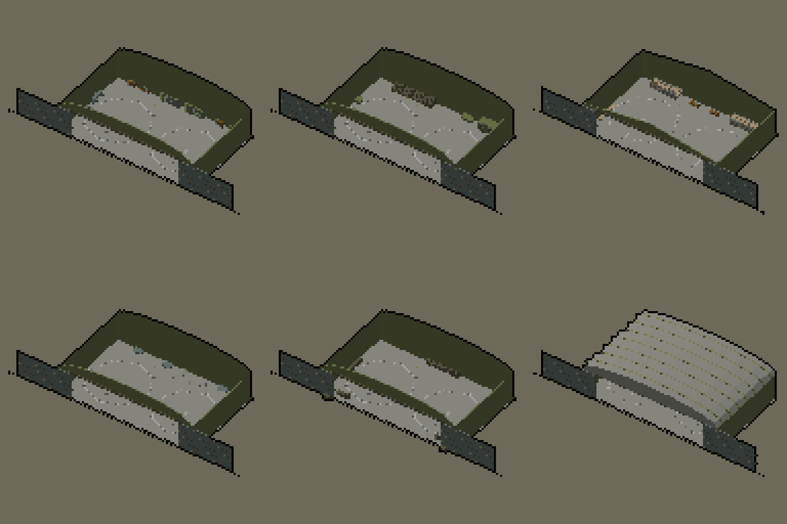
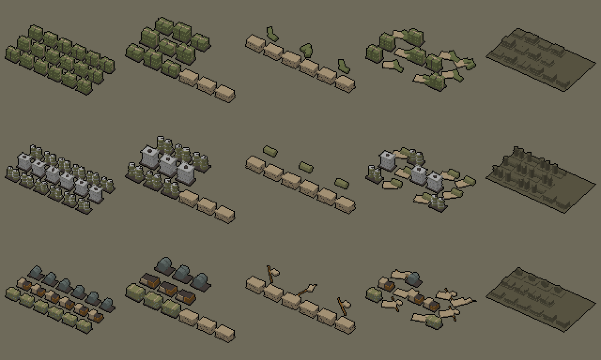
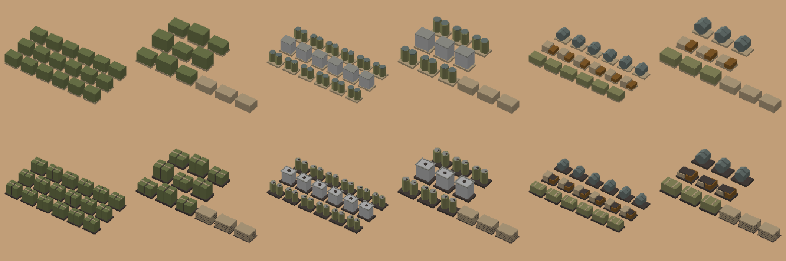

# Núcleo: hangar de Bétera en el que se entra y acopios de carga de las estaciones (Teo, 9-nov, noche)

Son los modelos para el bucle de Eugenio del 9-nov 21:59: entras en la zona, seleccionas helicópteros o el tren con lo que
vas a cargar, sales con la rueda al mapa y haces clic derecho en el destino. También sirven para la persistencia: lo que
hay en la zona se ve. Los dos llevan `T_Paleta32.png` (URP/Lit, `_BaseMap` = paleta), 5 variantes y LOD0/LOD1. La banda
de la horda queda al 0 %: no hay rojo, ámbar ni d4d0cc. Medidas SIN VERIFICAR. Exportado con `--costado 88885c --claro b8b8b8`.

## 1. `hangar_abierto/` → Resources/Models/Betera/hangar_abierto

`SM_HangarAbierto_v<n>_<Uso>`: Taller, Almacen, Refugio, Castigado, Fortificado. Es el hangar de `betera/hangar`
(40 × 25 m, muros de 8,5 m, clave a 12 m y hueco de 32 × 8 m), pero hueco por dentro y amueblado. Va en el mismo sitio de
`betera_instancias.csv` (SM_Hangar en X 90 y 160, Z 40; portón a +Z, hacia la plataforma). El hangar cerrado sigue sirviendo
para el panel y para las vistas lejanas.

**Jerarquía:** la raíz contiene los muros, el suelo y el interior, y tiene tres hijos:
- `Cubierta`: la bóveda (o las dos aguas), los nervios y la red. Su origen está a 8,5 m. **La vista la apaga, o la funde,
  al entrar en el hangar o al acercar la cámara**, para que se vean los NH90 desde arriba. Encendida, el hangar se ve como
  el cerrado.
- `Porton_O` y `Porton_E`: se entregan **abiertos**, con las hojas corridas 16 m hacia fuera. Para cerrar, cada hoja se
  traslada 16 m hacia el centro en X local. En hangar.py es al revés, porque aquel se entrega cerrado.

**Puestos de los NH90**, en coordenadas locales de Unity con yaw 0: (−10; 0; +1) y (+10; 0; +1), con el morro a +Z, hacia
el portón. Cada puesto tiene un círculo de 8,2 m de radio y su eje pintados en b8b8b8 fino. Los puestos están libres en
las cinco variantes, porque el mobiliario va pegado al fondo y a los costados. Los helicópteros son las unidades del juego
(`Vehiculos/nh90`), no van en el modelo: así se pueden seleccionar y sacar.

| v | Uso | Nave | Interior |
|---|---|---|---|
| 0 | Taller | bóveda | bancos, estanterías, carros y plataformas de mantenimiento |
| 1 | Almacen | bóveda | palés de cajas de munición, bidones y un contenedor de 20' |
| 2 | Refugio | dos aguas | literas, mesas y colchonetas |
| 3 | Castigado | bóveda con chapas arrancadas | chapas caídas y estanterías volcadas |
| 4 | Fortificado | bóveda con red | sacos a los lados del portón, por dentro y por fuera, y cajas |

*v0 a v4 sin la cubierta y, abajo a la derecha, v0 con ella (render del script, no de Unity).*

## 2. `acopio_carga/` → Resources/Models/Acopios (o junto a `Nules/acopio_viveres`)

`SM_Acopio<Recurso>_v<n>_<Estado>`, con Recurso = Municion, Combustible o Materiales (los de `TrenPreparar.Recurso`, aparte
de los víveres) y Estado = Lleno, Mitad, Vacio, Saqueado o Quemado. **Misma huella (10 × 6 m), mismo origen y misma regla
que `AcopioViveres`**: Lleno desde 2/3 de la capacidad de referencia, Mitad desde 1/3, Vacío por debajo, Saqueado si la
estación cae y Quemado si arde. Así, `AcopioViveres.Estado()` sirve para los cuatro cambiando solo el nombre del fichero.
Están pensados para el patio o el andén de carga de cada estación: al elegir la carga, el jugador ve cuánto hay, y al
volver encuentra lo que dejó.

- Munición: palés de cajas en 70784c con flejes.
- Combustible: bidones de 200 l y depósitos GRG (IBC) en jaula.
- Materiales: fardos de gaviones plegados, sacos terreros, tablones y rollos de concertina.
- En el estado Vacío quedan palés apilados y un resto que dice qué había.

*Filas: munición, combustible y materiales. Columnas: Lleno, Mitad, Vacío, Saqueado y Quemado.*

## 2b. Pase de contraste de los acopios (9-nov 23:40, por la captura qa52 de la I-Noche112)

Bruno vio en la captura a z26 que munición y combustible Lleno se leían como bloques lisos. En el juego se ve el **LOD1**,
que antes juntaba la carga de cada palé en un solo bloque, y el contorno negro de mis hojas el juego no lo tiene. Ahora los
dos LOD llevan el mismo dibujo y se mantienen los nombres, el origen y la huella:
- Cada palé tiene debajo una **base oscura** en 48403c (L* 28, el límite de la D-N80), un poco mayor que el palé, que lo
  separa del suelo. La carga va en bultos separados por **juntas de 0,1 m** sobre un núcleo de 48403c.
- Los **flejes** pasan de 605c48 a b4a080, sobre las cajas y sobre los gaviones. Las **tapas** de los bidones pasan de 6c7874
  a b8b8b8, con el tapón oscuro. Los GRG llevan un marco 94948c alrededor del depósito b8b8b8 y la boca en oscuro.
- Los palés vacíos apilados también llevan base y juntas oscuras.
- ΔL* que se consiguen: base y suelo de Sagunto (c19e78), 40; base y cajas (70784c), 21; flejes y cajas, 18; flejes y gaviones
  (88885c), 11; tapas y bidones, 19; marco y depósito del GRG, 14. Todos cumplen la regla de la sombra (≥ 8).
- **Huella real**, medida en el LOD1: Lleno y Mitad, 9,1 × 4,5 m; Quemado, 9,5 × 5,5 m (la mancha). Ninguna pasa de 10 × 6.
  En (102; 57,5), el Lleno ocupa Z de 55,2 a 59,8 y, con el VAMTAC en Z ≈ 51, quedan unos 3 m libres. Que parezcan pegados
  es la inclinación de la cámara, que corre hacia el VAMTAC la parte de arriba de las pilas.

*De izquierda a derecha: munición Lleno y Mitad, combustible Lleno y Mitad, materiales Lleno y Mitad. Render de día sobre
el suelo de Sagunto, sin contorno (como en el juego) y con el LOD1. No es una captura de Unity: la que vale es la de Sara o
la de Marcos.*

**Tabla de colores por celda, antes → ahora** (vértices leídos de los UV). La geometría cambia a propósito, así que la
comparación es por celda y no por vértice. Lo esperado: entra 48403c, sube b4a080 (flejes) y desaparece 605c48 en munición
y materiales; en combustible, b8b8b8 (tapas) y 48403c. El script no encontró ningún cambio fuera de eso ni nada en la banda.

| Modelo | LOD | Celda: antes → ahora |
|---|---|---|
| SM_AcopioMunicion_v0_Lleno | LOD0 | 70784c 2592→2592, b4a080 432→1728, 48403c 0→864, 605c48 432→0 |
| SM_AcopioMunicion_v0_Lleno | LOD1 | 48403c 0→864, 70784c 432→864, b4a080 432→864 |
| SM_AcopioMunicion_v1_Mitad | LOD0 | b4a080 504→1152, 70784c 1056→1056, 48403c 0→720, 605c48 216→0 |
| SM_AcopioMunicion_v1_Mitad | LOD1 | 48403c 0→720, b4a080 348→564, 70784c 216→432 |
| SM_AcopioMunicion_v2_Vacio | LOD0 | 48403c 0→576, b4a080 576→576, 70784c 144→144 |
| SM_AcopioMunicion_v2_Vacio | LOD1 | 48403c 0→576, b4a080 264→264, 70784c 72→72 |
| SM_AcopioMunicion_v3_Saqueado | LOD0 | 70784c 1200→1200, b4a080 312→744, 48403c 0→456, 605c48 144→0 |
| SM_AcopioMunicion_v3_Saqueado | LOD1 | 48403c 0→456, 70784c 312→456, b4a080 312→456 |
| SM_AcopioMunicion_v4_Quemado | LOD0 | 605c48 1656→1848 |
| SM_AcopioMunicion_v4_Quemado | LOD1 | 605c48 688→1456 |
| SM_AcopioCombustible_v0_Lleno | LOD0 | b8b8b8 144→6480, 6c7874 6336→0, 88885c 2112→2112, 48403c 0→1992, 94948c 576→864, b4a080 432→0 |
| SM_AcopioCombustible_v0_Lleno | LOD1 | 48403c 0→1872, b8b8b8 144→1296, 88885c 1152→1152, 6c7874 1152→0, 94948c 144→576, b4a080 432→0 |
| SM_AcopioCombustible_v1_Mitad | LOD0 | b8b8b8 72→3240, 6c7874 3168→0, 48403c 0→1284, 88885c 1056→1056, b4a080 504→288, 94948c 288→432 |
| SM_AcopioCombustible_v1_Mitad | LOD1 | 48403c 0→1224, b8b8b8 72→648, 88885c 576→576, 6c7874 576→0, b4a080 348→132, 94948c 72→288 |
| SM_AcopioCombustible_v2_Vacio | LOD0 | 48403c 0→576, b4a080 576→576, 88885c 204→204 |
| SM_AcopioCombustible_v2_Vacio | LOD1 | 48403c 0→576, b4a080 264→264, 88885c 144→144 |
| SM_AcopioCombustible_v3_Saqueado | LOD0 | b8b8b8 72→1656, 6c7874 1584→0, 88885c 1004→1004, 48403c 0→804, 94948c 288→432, b4a080 312→168 |
| SM_AcopioCombustible_v3_Saqueado | LOD1 | 48403c 0→744, 88885c 624→624, b8b8b8 72→360, b4a080 312→168, 6c7874 288→0, 94948c 72→288 |
| SM_AcopioCombustible_v4_Quemado | LOD0 | 605c48 4080→4272 |
| SM_AcopioCombustible_v4_Quemado | LOD1 | 605c48 2416→2608 |
| SM_AcopioMateriales_v0_Lleno | LOD0 | 6c7874 1776→1632, 845c28 504→576, 48403c 0→576, b4a080 552→432, 88885c 144→144 |
| SM_AcopioMateriales_v0_Lleno | LOD1 | 6c7874 576→576, 48403c 0→576, b4a080 552→432, 845c28 144→144, 88885c 144→144 |
| SM_AcopioMateriales_v1_Mitad | LOD0 | 6c7874 888→816, 48403c 0→576, b4a080 564→504, 845c28 252→288, 88885c 72→72 |
| SM_AcopioMateriales_v1_Mitad | LOD1 | 48403c 0→576, b4a080 408→348, 6c7874 288→288, 845c28 72→72, 88885c 72→72 |
| SM_AcopioMateriales_v2_Vacio | LOD0 | b4a080 648→648, 48403c 0→576, 845c28 72→72 |
| SM_AcopioMateriales_v2_Vacio | LOD1 | 48403c 0→576, b4a080 336→336, 845c28 72→72 |
| SM_AcopioMateriales_v3_Saqueado | LOD0 | b4a080 544→504, 845c28 420→456, 6c7874 416→368, 48403c 0→384, 88885c 48→48 |
| SM_AcopioMateriales_v3_Saqueado | LOD1 | b4a080 544→504, 48403c 0→384, 845c28 240→240, 6c7874 96→96, 88885c 48→48 |
| SM_AcopioMateriales_v4_Quemado | LOD0 | 605c48 1368→1720 |
| SM_AcopioMateriales_v4_Quemado | LOD1 | 605c48 864→1168 |

Bloques: `hangar_abierto.py` y `acopio_carga.py` del skill modelado-3d (TBD, rama `claude/modelado-3d-skill`).

## Tabla de colores por celda (leída de los UV, colores_uv.py)

Es la primera entrega de estos modelos, así que no hay entrega anterior con la que comparar. Ninguna celda cae en la banda
ni en los colores reservados (283440, 303424, 1c200c, 543820, 48403c, 442c0c, 50541c, 982420, e08c30, d4d0cc). En el hangar,
la tabla va por objeto (RAIZ, Cubierta y portones).

| Modelo | LOD | Celda y vértices |
|---|---|---|
| SM_HangarAbierto_v0_Taller | LOD0 | Cubierta: 88885c 686, 94948c 98; Porton_E: 605c48 120, 6c7874 24; Porton_O: 605c48 120, 6c7874 24; RAIZ: 6c7874 720, 70784c 696, b8b8b8 432, 845c28 96, 94948c 72, 605c48 72 |
| SM_HangarAbierto_v0_Taller | LOD1 | Cubierta: 88885c 232, 94948c 58; Porton_E: 605c48 72, 6c7874 24; Porton_O: 605c48 72, 6c7874 24; RAIZ: 6c7874 432, b8b8b8 240, 70784c 232, 845c28 96, 94948c 72, 605c48 72 |
| SM_HangarAbierto_v1_Almacen | LOD0 | Cubierta: 88885c 686, 94948c 98; Porton_E: 605c48 120, 6c7874 24; Porton_O: 605c48 120, 6c7874 24; RAIZ: 70784c 1808, 605c48 1008, b8b8b8 432, 845c28 384, 94948c 72 |
| SM_HangarAbierto_v1_Almacen | LOD1 | Cubierta: 88885c 232, 94948c 58; Porton_E: 605c48 72, 6c7874 24; Porton_O: 605c48 72, 6c7874 24; RAIZ: 70784c 1408, 845c28 384, b8b8b8 240, 94948c 72, 605c48 72 |
| SM_HangarAbierto_v2_Refugio | LOD0 | Cubierta: 88885c 266, 94948c 38; Porton_E: 605c48 120, 6c7874 24; Porton_O: 605c48 120, 6c7874 24; RAIZ: 6c7874 1776, b4a080 720, b8b8b8 432, 70784c 172, 94948c 72, 605c48 72, 845c28 48 |
| SM_HangarAbierto_v2_Refugio | LOD1 | Cubierta: 88885c 152, 94948c 38; Porton_E: 605c48 72, 6c7874 24; Porton_O: 605c48 72, 6c7874 24; RAIZ: b4a080 720, 6c7874 624, b8b8b8 240, 70784c 172, 94948c 72, 605c48 72, 845c28 48 |
| SM_HangarAbierto_v3_Castigado | LOD0 | Cubierta: 88885c 490, 94948c 98, 605c48 72; Porton_E: 605c48 120, 6c7874 24; Porton_O: 605c48 120, 6c7874 24; RAIZ: 70784c 552, b8b8b8 432, 94948c 168, 605c48 96, 6c7874 72, 845c28 24 |
| SM_HangarAbierto_v3_Castigado | LOD1 | Cubierta: 88885c 116, 605c48 72, 94948c 58; Porton_E: 605c48 72, 6c7874 24; Porton_O: 605c48 72, 6c7874 24; RAIZ: 70784c 328, b8b8b8 240, 94948c 168, 605c48 72, 6c7874 72, 845c28 24 |
| SM_HangarAbierto_v4_Fortificado | LOD0 | Cubierta: 88885c 806, 94948c 98; Porton_E: 605c48 120, 6c7874 24; Porton_O: 605c48 120, 6c7874 24; RAIZ: 605c48 1032, 70784c 456, b8b8b8 432, 845c28 144, 94948c 72 |
| SM_HangarAbierto_v4_Fortificado | LOD1 | Cubierta: 88885c 352, 94948c 58; Porton_E: 605c48 72, 6c7874 24; Porton_O: 605c48 72, 6c7874 24; RAIZ: 70784c 376, b8b8b8 240, 605c48 216, 845c28 144, 94948c 72 |
| SM_AcopioMunicion_v0_Lleno | LOD0 | 70784c 2592, b4a080 432, 605c48 432 |
| SM_AcopioMunicion_v0_Lleno | LOD1 | b4a080 432, 70784c 432 |
| SM_AcopioMunicion_v1_Mitad | LOD0 | 70784c 1056, b4a080 504, 605c48 216 |
| SM_AcopioMunicion_v1_Mitad | LOD1 | b4a080 348, 70784c 216 |
| SM_AcopioMunicion_v2_Vacio | LOD0 | b4a080 576, 70784c 144 |
| SM_AcopioMunicion_v2_Vacio | LOD1 | b4a080 264, 70784c 72 |
| SM_AcopioMunicion_v3_Saqueado | LOD0 | 70784c 1200, b4a080 312, 605c48 144 |
| SM_AcopioMunicion_v3_Saqueado | LOD1 | b4a080 312, 70784c 312 |
| SM_AcopioMunicion_v4_Quemado | LOD0 | 605c48 1656 |
| SM_AcopioMunicion_v4_Quemado | LOD1 | 605c48 688 |
| SM_AcopioCombustible_v0_Lleno | LOD0 | 6c7874 6336, 88885c 2112, 94948c 576, b4a080 432, b8b8b8 144 |
| SM_AcopioCombustible_v0_Lleno | LOD1 | 88885c 1152, 6c7874 1152, b4a080 432, b8b8b8 144, 94948c 144 |
| SM_AcopioCombustible_v1_Mitad | LOD0 | 6c7874 3168, 88885c 1056, b4a080 504, 94948c 288, b8b8b8 72 |
| SM_AcopioCombustible_v1_Mitad | LOD1 | 88885c 576, 6c7874 576, b4a080 348, b8b8b8 72, 94948c 72 |
| SM_AcopioCombustible_v2_Vacio | LOD0 | b4a080 576, 88885c 204 |
| SM_AcopioCombustible_v2_Vacio | LOD1 | b4a080 264, 88885c 144 |
| SM_AcopioCombustible_v3_Saqueado | LOD0 | 6c7874 1584, 88885c 1004, b4a080 312, 94948c 288, b8b8b8 72 |
| SM_AcopioCombustible_v3_Saqueado | LOD1 | 88885c 624, b4a080 312, 6c7874 288, b8b8b8 72, 94948c 72 |
| SM_AcopioCombustible_v4_Quemado | LOD0 | 605c48 4080 |
| SM_AcopioCombustible_v4_Quemado | LOD1 | 605c48 2416 |
| SM_AcopioMateriales_v0_Lleno | LOD0 | 6c7874 1776, b4a080 552, 845c28 504, 88885c 144 |
| SM_AcopioMateriales_v0_Lleno | LOD1 | 6c7874 576, b4a080 552, 88885c 144, 845c28 144 |
| SM_AcopioMateriales_v1_Mitad | LOD0 | 6c7874 888, b4a080 564, 845c28 252, 88885c 72 |
| SM_AcopioMateriales_v1_Mitad | LOD1 | b4a080 408, 6c7874 288, 88885c 72, 845c28 72 |
| SM_AcopioMateriales_v2_Vacio | LOD0 | b4a080 648, 845c28 72 |
| SM_AcopioMateriales_v2_Vacio | LOD1 | b4a080 336, 845c28 72 |
| SM_AcopioMateriales_v3_Saqueado | LOD0 | b4a080 544, 845c28 420, 6c7874 416, 88885c 48 |
| SM_AcopioMateriales_v3_Saqueado | LOD1 | b4a080 544, 845c28 240, 6c7874 96, 88885c 48 |
| SM_AcopioMateriales_v4_Quemado | LOD0 | 605c48 1368 |
| SM_AcopioMateriales_v4_Quemado | LOD1 | 605c48 864 |