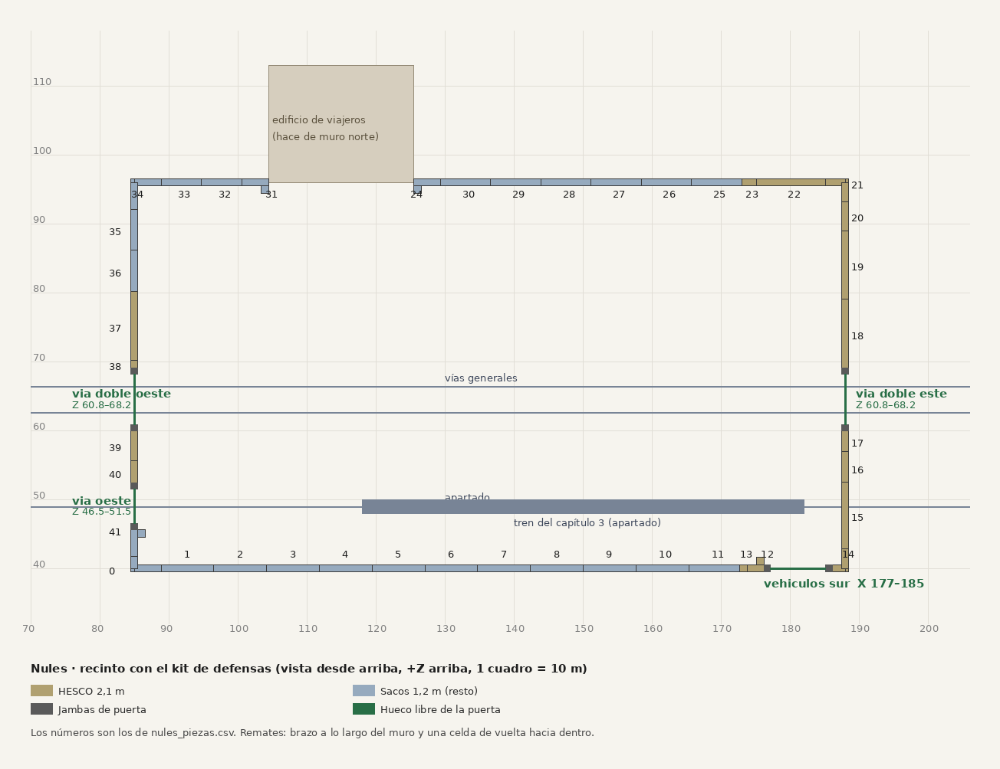

# Recinto de Nules con el kit de defensas, cortado por las jambas · Teo, 9-nov

Encargo de Lucía (9-nov). Es la lista de colocación de Nules con el muro cortado **por fuera de las jambas de 0,9 m** de cada puerta, igual que en Sagunto. Va primero porque Nules entra en juego la noche 2. **Revisada por Álvaro; falta su último vistazo.**

## Archivos
- `nules_recinto.json`: el recinto, el material de cada lado, las 4 puertas y las 42 piezas (campos de `PiezaMuro` y su `ruta` en `Models/`).
- `nules_piezas.csv`: una pieza por fila, con los números del plano.
- `codigo/`: `driver_nules.py` lee `estacion_nules.json` de `marcos/noche-prototipo` y hace lo mismo que `RecintoPlan.Nules()` (HESCO en el frente este y en alas de 15 m, sacos en el resto, el edificio como muro norte), con las reglas de abajo. Se ejecuta con `python3 driver_nules.py estacion_nules.json salida.json --mover-vehiculos`.

## Revisión de Álvaro (9-nov, `nules-nivel.md` §14), ya aplicada
1. **Puerta de vehículos en X 177,22–185,22** (está también en su CSV de obstáculos). Con eso, el brazo de la esquina SE acaba en el borde del hueco y la jamba este queda dentro del brazo. Con los 178–186 de hoy, el brazo se metía 0,78 m en el hueco. **El JSON del juego tiene que pasar a `hueco_x` 177,22–185,22 y `pos` (181,22; 40)**: es un cambio de sólidos, lo toca Marcos.
2. **Muro oeste en HESCO sobre los andenes:** de Z 52,4 a 59,9 (entre las jambas del apartado y de la doble) y de Z 69,1 a 80,21 (un tramo de 10 m y una celda; pasa el borde del andén en Z 79,2). Sobre un andén de 0,68 m, los sacos de 1,2 m solo asomaban 0,52 m. El resto del oeste sigue en sacos.
3. **Sin remates en las puertas dobles** (este y oeste): sus celdas de vuelta caerían sobre el andén, donde se descarga el tren. Se cierran con cortos. Quedan 4 remates: el de la jamba sur del apartado (41), el de la jamba oeste de vehículos (12) y los dos del edificio (24 y 31).
4. El solape de 2,2 m entre la esquina SO y el remate del apartado se queda (si se quita, queda un hueco de 1,7 m).

## Coste (para Hugo)
`CosteLineal`, con el hueco libre de las puertas como lo calcula el código: **90,24 u de muro + 42 u de puertas = 132,24 u**. Antes eran 82,08 + 42 = 124,08 (los 124,3 u de la D-N177). Sube **8,16 u** porque 20,41 m del muro oeste pasan de sacos (0,2 u/m) a HESCO (0,6 u/m). Para que el juego cuente lo mismo, `RecintoPlan.Nules()` tiene que dar HESCO a esos dos trozos del oeste. Las puertas no se mueven, salvo la de vehículos (que mide lo mismo), así que las fracciones de la D-N177 no cambian.

## Cómo está hecho
- Las piezas se cortan **por fuera de las jambas de 0,9 m**: Z 59,9–69,1 en las dobles, Z 45,6–52,4 en la del apartado y X 176,32–186,12 en la de vehículos. El coste no usa esos cortes (`hueco_muro_z`/`hueco_muro_x`), sino el hueco libre.
- El resto se reparte como en Sagunto: en los sacos, tramos iguales (de escala 0,74 a 1,09); en el HESCO, cortos seguidos y centrados. Si la esquina ya cubre el trozo, no se pone nada.
- En X 173 (alas) y en Z 52,4 y 80,21 (oeste), el HESCO de 2,1 m se junta con los sacos de 1,2 m sin pieza de transición.
- `python3 driver_nules.py estacion_nules.json salida.json --mover-vehiculos --oeste-hesco`, y después `puertas_nules.py` y `postpro.py`.

## Para importar
Necesita `SM_SacosRemateEspejo` (2 piezas), igual que Sagunto (IMPORTAR-NOCHE §5). Las puertas: `Nules/puerta_via_doble` (v4 Blindada en las dos), `Defensas/puerta_via` (v3 MallaEspino) y `Defensas/muro/SM_PuertaVehiculos` (v4 Blindada). Las variantes salen de `VariantOf` en la posición de cada puerta. Las colisiones están en `Defensas/colision/`.

— Teo · [retrato](/mnt/project-files/equipo/retrato_teo_64_x4.png)
