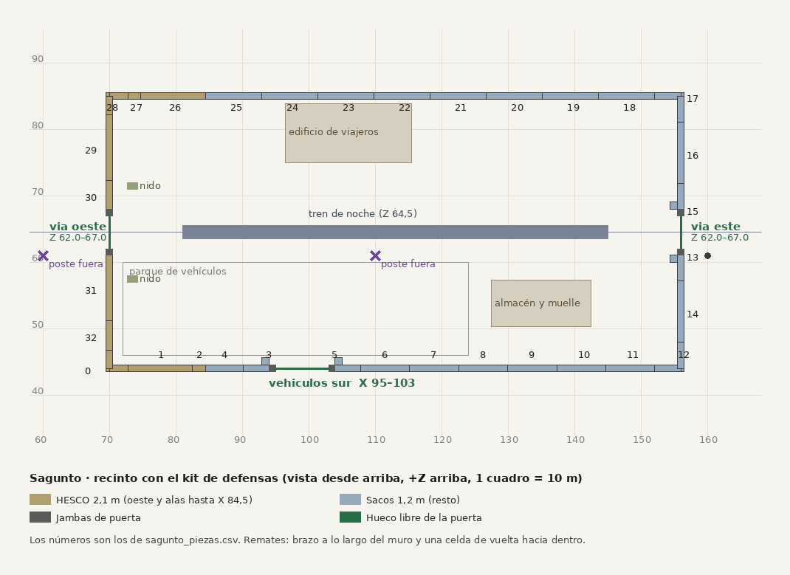

# Recinto de Sagunto con el kit de defensas · Teo, 9-nov

Encargo de Lucía (9-nov): la lista de colocación de Sagunto en el formato de `RecintoPlan`, con HESCO al oeste y en las alas y sacos en el resto. **Revisada por Álvaro** (`docs/niveles/sagunto-nivel.md` §10.22): quita la puerta oeste-sur y los remates con vuelta del muro oeste. Las líneas de tiro del capítulo 3, R1 y R2 no cambian.

## Archivos
- `sagunto_recinto.json`: el recinto, el material de cada lado, las 3 puertas, las 33 piezas y los postes de catenaria que sobran. Cada pieza lleva los campos de `PiezaMuro` (malla, x, z, yaw, largo, escala_x, espejo) y su `ruta` en `Assets/TBD/Resources/Models/`.
- `sagunto_piezas.csv`: lo mismo, una pieza por fila. Los números son los del plano.
- `codigo/`: `plan.py` es una copia en Python de `RecintoPlan.Plan` (rama `marcos/noche-prototipo`) con los cambios de abajo. `driver.py` saca la lista (`python3 driver.py salida.json`, y con `--literal` sale lo que haría el código de hoy). `postpro.py` añade las rutas y el CSV, y `plano.py` dibuja el plano.

## De dónde sale
- Recinto: X 70–156, Z 44–85 (`docs/niveles/sagunto_obstaculos_v1.csv`). HESCO de 2,1 m en el muro oeste y en las alas hasta X 84,5; sacos de 1,2 m en el resto. Mismos ejes y alturas que los sólidos del CSV.
- Variante de cada pieza: la del código, `EstacionDato.VariantOf(x, z, 5)`. Todas en estado e0 Sano.
- Puertas:

| Puerta | Posición, giro | Hueco libre | Hueco en el muro (con jambas de 0,9 m) | Malla |
|---|---|---|---|---|
| Vía oeste | (70; 64,5), yaw 270 | Z 62–67 (5 m, D-N151) | Z 61,1–67,9 | `Defensas/puerta_via/SM_PuertaVia_v1_ChapaOndulada` |
| Vía este | (156; 64,5), yaw 90 | Z 62–67 (confirmada por Álvaro), solo visual y cerrada en el MVP | Z 61,1–67,9 | `Defensas/puerta_via/SM_PuertaVia_v4_Blindada` |
| Vehículos sur (E4) | (99; 44), yaw 180 | X 95–103 | X 94,1–103,9 | `Defensas/muro/SM_PuertaVehiculos_v2_Tablones` |

Cada puerta lleva su colisión de `Defensas/colision/` (IMPORTAR-NOCHE).

## Lo que cambia respecto a `RecintoPlan` tal cual
1. **El muro se corta por fuera de las jambas**, no por el hueco libre, porque las jambas quedan por fuera de los 5 m y de los 8 m (`puerta-via/LEEME.md`). *Marcos: en Nules el JSON da el hueco libre (`hueco_z` 60,8–68,2), así que allí los remates pisan las jambas.*
2. **Muro oeste sin remates** (Álvaro): la celda de vuelta pisaría la banqueta. Los dos lados de la puerta de vía se cierran con un `HescoCorto4` (piezas 30 y 32).
3. **El resto se centra.** En HESCO va un solo corto centrado (prefiero que solape unos centímetros a que quede un agujero de 0,4 m). En sacos, cada trozo se reparte en tramos iguales, de escala 0,71 a 1,16, en vez de dejar al final un tramo aplastado a 0,16.

## Postes de catenaria
El bucle de `PrototypeBootstrap.cs:1377` (un poste cada 50 m en Z 60,9, sin cable) tiene que saltarse **X 60 y X 110**. El de X 110 cae dentro del fuerte, junto al tren (el suelto de la qa47); el de X 60 cae en la calle del paso a nivel. Los de fuera se quedan.

## Para importar
- Las piezas y las puertas ya están en Unity o van en IMPORTAR-NOCHE, **menos `SM_SacosRemateEspejo`** (piezas 5 y 15), que no está en Unity. Hay que copiar los 40 FBX de `entregas/teo-modelado/defensas/sacos/SM_SacosRemateEspejo_*` a `Assets/TBD/Resources/Models/Defensas/sacos/`.
- Las piezas con `espejo: true` ya llevan el nombre de la malla espejada; no hay que escalarlas a −1.
- En X 84,5 el HESCO (2,1 m) se junta con los sacos (1,2 m) sin pieza de transición, como en el CSV.

— Teo · [retrato](/mnt/project-files/equipo/retrato_teo_64_x4.png)
