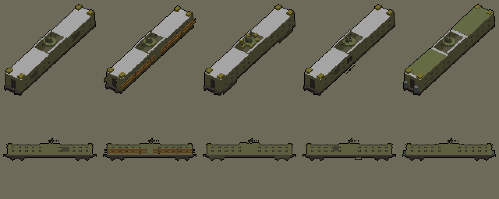

# R3 · Vagón blindado: el tren dispara (D-N189) (Teo, 9-nov, noche)

Sale de la D-N189 (Lucía, 22:25; GDD §15c): un vagón con ametralladora que ocupa una plaza de carga. **Parte del R2 · Vagón de
tropa**: tiene la misma plataforma, las mismas cotas (19,9 m entre topes, tablero a 1,25 m, bogies a ±7 m) y los mismos topes,
así que **engancha igual que el R2**. Iker hace el enganche y el fuego. Lleva `T_Paleta32.png` (URP/Lit, `_BaseMap` = paleta),
5 variantes y LOD0/LOD1. Exportado con `--costado 88885c --claro b8b8b8`, como el R2 (regla del 9-nov), con el lateral en
88885c y el techo en b8b8b8. Medidas SIN VERIFICAR. Propongo la carpeta `Resources/Models/R3`.

**Jerarquía** (mira a +Z en Unity):
- `SM_R3_VagonBlindado_v<n>_<Forro>_LODn`: el casco. Origen en el suelo, en el centro del vagón.
- `Torre`, hija del casco: el anillo, el escudo y la ametralladora. Origen en el eje de giro, a 3,35 m de alto (en Unity,
  (0; 3,35; 0)). **Gira sobre su Y**. No tiene elevación, porque el tiro va por el plano.
- `Muzzle_0`, hijo de la Torre: un vacío en la boca, a 1,85 m por delante del eje y 4,23 m de alto. **El disparo sale por su
  +Z local**, como en las demás bocas (Dragón, VAMTAC y soldado).

Casamata de chapa de 2,1 m, techada en los dos tercios de los extremos, con una puerta en cada testero, aspilleras a dos
alturas y el pozo de la torreta en el centro (4,4 m abierto). Bastidor, ruedas, aspilleras y arma van en 48403c (D-N80: nada
por debajo de L* 28; el R2 de antes usa 303424 y 1c200c, que están en la banda de la horda).

| v | Forro | Qué se ve |
|---|---|---|
| 0 | Chapa | chapa soldada lisa con remiendos |
| 1 | Traviesas | traviesas de madera atadas por fuera, de un taller sin acero |
| 2 | Faldones | faldones de chapa sobre los bogies y sacos alrededor de la torreta |
| 3 | Castigado | abolladuras, una chapa colgando con su hueco y el escudo doblado |
| 4 | Camuflado | red sobre los techos y bidones en los testeros |

Bloque: `vagon_blindado.py` del skill modelado-3d (TBD, rama `claude/modelado-3d-skill`).

## Tabla de colores por celda (leída de los UV, colores_uv.py)

Es la primera entrega de este vagón, así que no hay entrega anterior con la que comparar. Con el R2 comparte el lateral
(88885c), el techo (b8b8b8), el piso y los remiendos (605c48) y los sacos (847c34). Lo que antes iba en 303424 y 1c200c
(bastidor, ruedas y metal) aquí va en 48403c. Ninguna celda cae en la banda ni en los colores reservados (283440, 303424,
1c200c, 543820, 442c0c, 50541c, 982420, e08c30, d4d0cc).

| Modelo | LOD | Celda y vértices por objeto |
|---|---|---|
| SM_R3_VagonBlindado_v0_Chapa | LOD0 | RAIZ: 48403c 3272, 88885c 192, 605c48 144, 847c34 96, b8b8b8 48; Torre: 70784c 204, 48403c 116 |
| SM_R3_VagonBlindado_v0_Chapa | LOD1 | RAIZ: 48403c 1032, 88885c 192, 605c48 144, 847c34 96, b8b8b8 48; Torre: 70784c 140, 48403c 96 |
| SM_R3_VagonBlindado_v1_Traviesas | LOD0 | RAIZ: 48403c 3464, 845c28 768, 88885c 192, 847c34 96, 605c48 72, b8b8b8 48; Torre: 70784c 204, 48403c 116 |
| SM_R3_VagonBlindado_v1_Traviesas | LOD1 | RAIZ: 48403c 1032, 88885c 192, 845c28 192, 847c34 96, 605c48 72, b8b8b8 48; Torre: 70784c 140, 48403c 96 |
| SM_R3_VagonBlindado_v2_Faldones | LOD0 | RAIZ: 48403c 3272, 847c34 240, 88885c 192, 605c48 168, b8b8b8 48; Torre: 70784c 204, 48403c 116 |
| SM_R3_VagonBlindado_v2_Faldones | LOD1 | RAIZ: 48403c 1032, 847c34 240, 88885c 192, 605c48 168, b8b8b8 48; Torre: 70784c 140, 48403c 96 |
| SM_R3_VagonBlindado_v3_Castigado | LOD0 | RAIZ: 48403c 3296, 88885c 208, 605c48 124, 847c34 96, b8b8b8 52; Torre: 70784c 204, 48403c 116 |
| SM_R3_VagonBlindado_v3_Castigado | LOD1 | RAIZ: 48403c 1032, 88885c 208, 605c48 124, 847c34 96, b8b8b8 52; Torre: 70784c 140, 48403c 96 |
| SM_R3_VagonBlindado_v4_Camuflado | LOD0 | RAIZ: 48403c 3272, 6c7874 352, 88885c 192, 847c34 96, 605c48 72, b8b8b8 48, 70784c 48; Torre: 70784c 204, 48403c 116 |
| SM_R3_VagonBlindado_v4_Camuflado | LOD1 | RAIZ: 48403c 1032, 88885c 192, 6c7874 192, 847c34 96, 605c48 72, b8b8b8 48, 70784c 48; Torre: 70784c 140, 48403c 96 |