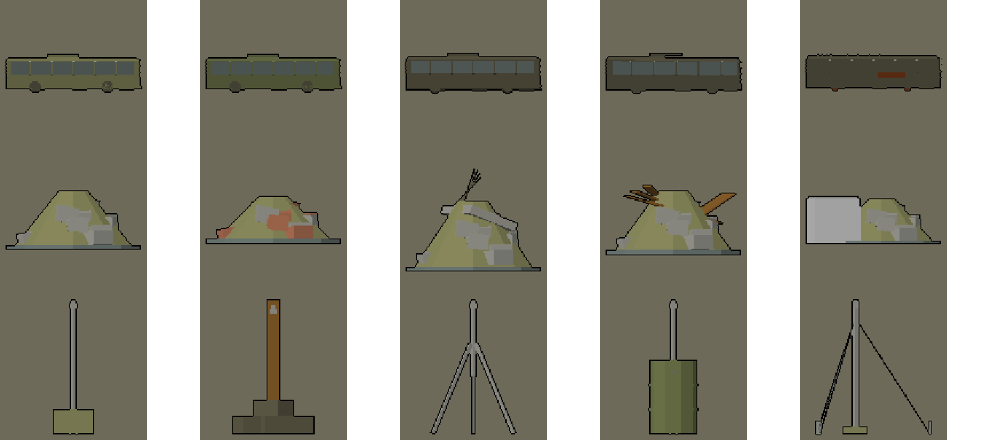

# Cajas grises de Sagunto y Nules: autobús, escombro y poste del foco (Teo, 9-nov, noche)

Sale de la lista de Bruno (`docs/arte/modelos-en-zonas.md`, 22:30): son tres de las cajas que siguen en la escena de
Sagunto/Nules. Bruno las cablea. Las tres llevan `T_Paleta32.png` (URP/Lit, `_BaseMap` = paleta), con 5 variantes y LOD0/LOD1.
La banda de la horda queda al 0 %: no hay rojo, ámbar ni d4d0cc. Medidas SIN VERIFICAR. Exportado con
`--costado 88885c --claro b8b8b8` (regla del 9-nov). Origen en el suelo y en el centro, salvo el poste, que va en su eje.

| Carpeta (→ Resources/Models/Urbano/…) | Fichero | Sustituye a | Notas |
|---|---|---|---|
| `autobus` | `SM_Autobus_v<n>_<Estado>`: Abandonado, PuertasAbiertas, Pinchado, Accidentado, Quemado | `Autobús cruzado` (59; 92) | 11,0 × 2,55 × 3,0 m. **Largo a lo largo de Z** (delante = +Z): la caja del código tiene el largo en X con yaw 74, así que con el modelo va **yaw 164**. Puertas en +X. |
| `escombro` | `SM_MontonEscombro_v<n>_<Tipo>`: Cascotes, Ladrillo, Ferralla, Tablones, Sacas | los 8 `Escombro` (Z 100–104) | Planta de unos 2,3 × 2,3 m y de 0,8 a 1,4 m de alto. Una pieza por solar (en vez de 4 cajas), con la variante por hash de la posición. |
| `poste_foco` | `SM_PosteFoco_v<n>_<Montaje>`: Hormigon, Madera, Tripode, Bidon, Vientos | `Poste del foco` | El brazo deja el soporte del foco a 1,6 m de alto y 0,3 m hacia −X. El código pone el poste en pos + (0,3; −0,8; 0), así que el modelo va en **pos + (0,3; −1,6; 0)** con el origen en el suelo. |

**Camión del atasco:** no hace falta modelo nuevo. Son los `SM_CocheCivil_Camion_v0..v4` de `coches-civiles/`, que hay que
importar con su paleta. Tienen 6,6 m. Para la cabeza del atasco pegan el v3 (accidentado) o el v1 (con la puerta abierta).

Bloques: `autobus.py`, `monton_escombro.py` y `poste_foco.py` del skill modelado-3d (TBD, rama `claude/modelado-3d-skill`).

## Tabla de colores por celda (leída de los UV, colores_uv.py)

Es la primera entrega de estos modelos, así que no hay entrega anterior con la que comparar. Ninguna celda cae en la banda
ni en los colores reservados (283440, 303424, 1c200c, 543820, 48403c, 442c0c, 50541c, 982420, e08c30, d4d0cc). En el
autobús, las caras de abajo van en 605c48 porque por defecto salían en 303424.

| Modelo | LOD | Celda y vértices |
|---|---|---|
| SM_Autobus_v0_Abandonado | LOD0 | 605c48 492, 88885c 328, 6c7874 192, b8b8b8 64 |
| SM_Autobus_v0_Abandonado | LOD1 | 605c48 292, 88885c 120, 6c7874 72, b8b8b8 24 |
| SM_Autobus_v1_PuertasAbiertas | LOD0 | 605c48 504, 70784c 328, 6c7874 192, 88885c 124 |
| SM_Autobus_v1_PuertasAbiertas | LOD1 | 605c48 304, 70784c 168, 6c7874 144, 88885c 36 |
| SM_Autobus_v2_Pinchado | LOD0 | 605c48 772, 6c7874 192, 847c34 64, 88885c 48 |
| SM_Autobus_v2_Pinchado | LOD1 | 605c48 412, 6c7874 72, 847c34 24 |
| SM_Autobus_v3_Accidentado | LOD0 | 605c48 776, 6c7874 192, b4a080 60, 88885c 48 |
| SM_Autobus_v3_Accidentado | LOD1 | 605c48 416, 6c7874 72, b4a080 20 |
| SM_Autobus_v4_Quemado | LOD0 | 7c3c18 440, 605c48 416, 94948c 60 |
| SM_Autobus_v4_Quemado | LOD1 | 7c3c18 168, 605c48 132, 94948c 8 |
| SM_MontonEscombro_v0_Cascotes | LOD0 | 94948c 336, 88885c 68, 6c7874 68 |
| SM_MontonEscombro_v0_Cascotes | LOD1 | 94948c 120, 88885c 48, 6c7874 48 |
| SM_MontonEscombro_v1_Ladrillo | LOD0 | a86c50 312, 94948c 120, 88885c 68, 6c7874 68 |
| SM_MontonEscombro_v1_Ladrillo | LOD1 | a86c50 72, 94948c 48, 88885c 48, 6c7874 48 |
| SM_MontonEscombro_v2_Ferralla | LOD0 | 94948c 360, 605c48 96, 88885c 68, 6c7874 68 |
| SM_MontonEscombro_v2_Ferralla | LOD1 | 94948c 144, 88885c 48, 6c7874 48, 605c48 48 |
| SM_MontonEscombro_v3_Tablones | LOD0 | 94948c 336, 845c28 96, 88885c 68, 6c7874 68 |
| SM_MontonEscombro_v3_Tablones | LOD1 | 94948c 120, 845c28 96, 88885c 48, 6c7874 48 |
| SM_MontonEscombro_v4_Sacas | LOD0 | 94948c 384, 88885c 68, 6c7874 68, b8b8b8 48 |
| SM_MontonEscombro_v4_Sacas | LOD1 | 94948c 168, 88885c 48, 6c7874 48, b8b8b8 48 |
| SM_PosteFoco_v0_Hormigon | LOD0 | 94948c 116, 88885c 24 |
| SM_PosteFoco_v0_Hormigon | LOD1 | 94948c 96, 88885c 24 |
| SM_PosteFoco_v1_Madera | LOD0 | 605c48 120, 94948c 48, 845c28 24 |
| SM_PosteFoco_v1_Madera | LOD1 | 94948c 48, 605c48 48, 845c28 24 |
| SM_PosteFoco_v2_Tripode | LOD0 | 94948c 188 |
| SM_PosteFoco_v2_Tripode | LOD1 | 94948c 168 |
| SM_PosteFoco_v3_Bidon | LOD0 | 70784c 264, 94948c 116, 6c7874 24 |
| SM_PosteFoco_v3_Bidon | LOD1 | 94948c 96, 70784c 48 |
| SM_PosteFoco_v4_Vientos | LOD0 | 94948c 188, 6c7874 72, 88885c 24 |
| SM_PosteFoco_v4_Vientos | LOD1 | 94948c 168, 6c7874 72, 88885c 24 |