# Arte

Pruebas de arte del 5-nov-2026: piloto de Pixelab (capa 2D), una imagen de referencia por la API de
ElevenLabs y una prueba 3D con Hunyuan. **Nada de esto está aprobado todavía**: el estilo lo aprueba Eugenio
antes de lanzar el lote (columna `aprobado` de `assets/pixelab/registro.csv`, vacía).

## 1. Piloto de Pixelab (capa 2D)

**Gasto real: 78 generaciones** de las unas 150 previstas. Saldo antes: 8.825,05. Saldo después: 8.747,05
(medido con `get_balance`). El plan se reinicia el **17-nov-2026**. Los 42 elementos están en
`assets/pixelab/` y registrados en `assets/pixelab/registro.csv` con prompt, semilla, coste y fecha.

**Etiqueta de estilo usada en todos los prompts:** `pixel art, gritty post-apocalyptic military, muted
desaturated palette, rust, olive drab, concrete grey, dried blood red, high contrast silhouettes, no text`.

### Coste real por herramienta (medido)

| Herramienta | Uso en el piloto | Coste medido |
| --- | --- | --- |
| `create_image_pixen` | 16×16, 32×32, 64×64 y 512×288 | **1 generación** por imagen, a cualquier tamaño probado |
| `create_character` (modo v3, 64 px) | Zombi común, 8 direcciones | **2 generaciones** |
| `animate_character` (plantilla `scary-walk`, 8 fotogramas) | 8 direcciones | **1 por dirección** = 8 |
| `create_ui_asset` (256×256, elementos `panel` + `button`) | Panel y botón en una sola hoja | **10 generaciones** por llamada |
| `create_image_pro` (320×180) | Ilustración de evento | **10 generaciones**, devuelve 1 candidato |

### Resultados por bloque

| Bloque | Cantidad | Gen. | Lectura |
| --- | --- | --- | --- |
| Iconos de recursos (32×32) | 4 × 3 | 12 | Buen nivel y paleta coherente. Algunas variantes con exceso de salpicaduras rojas. `materiales_b` salió **con fondo opaco** pese a pedir transparencia. |
| Iconos de órdenes (16×16) | 3 × 2 | 6 | Pendiente de revisar legibilidad a tamaño real. |
| Fichas del mapa (32×32) | 4 × 2 | 8 | **Vistas inconsistentes**: unas salen en bloque isométrico y otras en plano cenital. Hay que fijar la proyección. |
| Retratos (64×64) | 2 × 3 | 6 | El mejor resultado del piloto: coherentes, con carácter y muy usables. |
| Personaje 8 direcciones + andar | 1 | 10 | Ocho direcciones coherentes y andar de 8 fotogramas. Sale un parche con bandera en el hombro que no se pidió. |
| VFX | 2 | 2 | **Son fotogramas sueltos, no animaciones**; no se ha medido el coste de animar. El fogonazo salió con un soldado dibujado: hay que pedir «solo el efecto, sin personaje». |
| UI | 2 hojas | 20 | Panel y botón con buen aspecto; el botón trae un texto («START») pese a pedir «no text». |
| Ilustración de evento | 3 | 12 | Con `pixen` a 512×288 (1 gen.) se obtiene una imagen más grande y de buena calidad; la de `pro` (10 gen.) es más dramática pero más pequeña. Mejor valor: `pixen`. |
| Decals (64×64) | 2 | 2 | El escombro sale aislado; la sangre trae el suelo de fondo (no es un decal limpio). |

### Hojas de contacto (ampliadas ×4 a ×16, escalado sin suavizar)

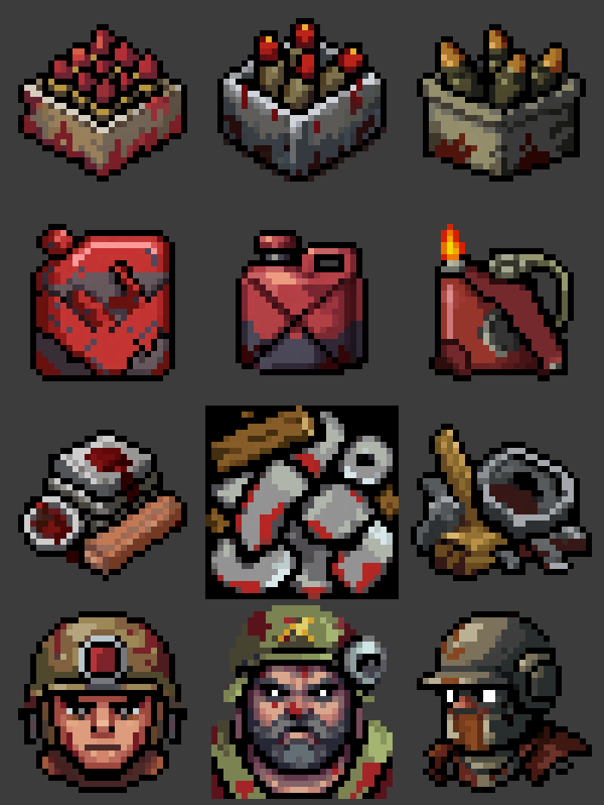
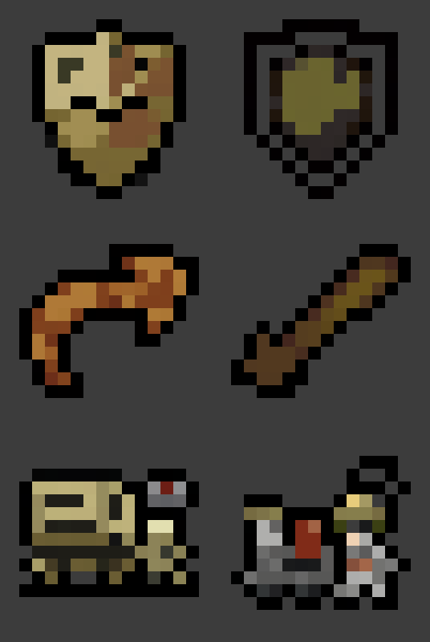
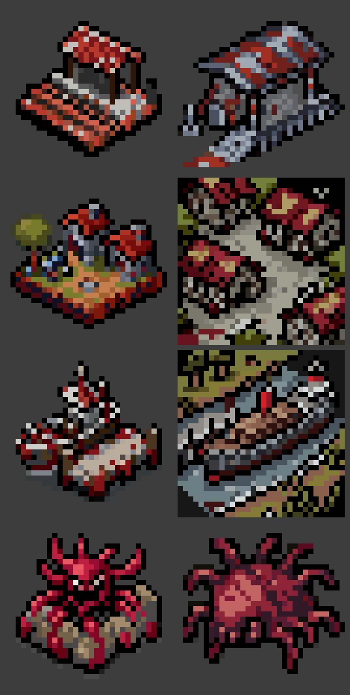
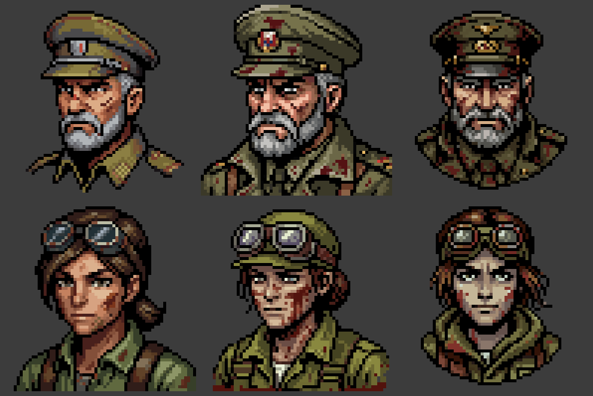
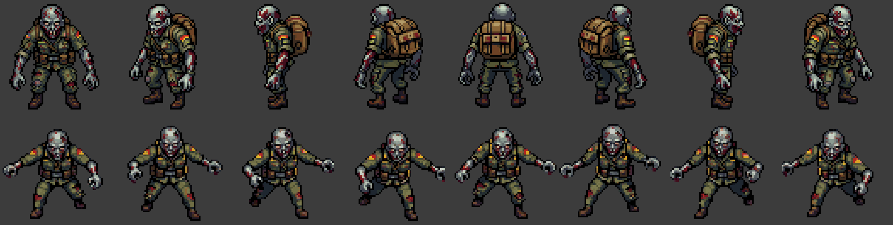
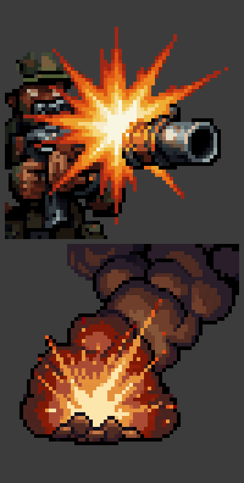
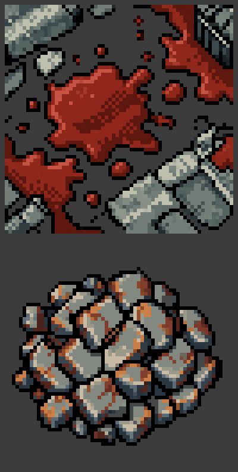

### Ilustraciones de evento

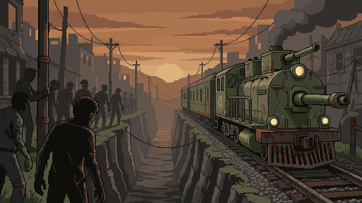
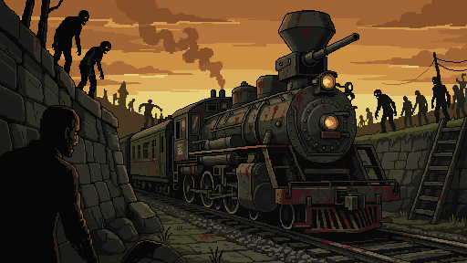
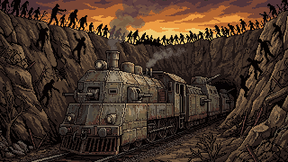

### Qué haría distinto en el lote
1. **Fijar la proyección** de las fichas del mapa en el prompt y usar una de las herramientas de mapa si hace falta coherencia.
2. Pedir **fondo transparente de forma explícita** y comprobar la transparencia de cada archivo antes de aceptarlo.
3. Para VFX, pedir «solo el efecto, sin personaje ni arma» y decidir si se animan con herramientas de efectos.
4. **Paleta fija**: ninguna herramienta de este piloto la forzó. Se puede pasar una paleta a `create_image_pro` y a `create_ui_asset`; para el resto, ajustar después con la herramienta de reducción de colores (cuesta unas 0,1 generaciones).
5. Coste estimado de un impostor con tres animaciones y 8 direcciones: 2 + 3 × 8 = **26 generaciones**. Un lote de unos 8.600 admite del orden de cientos de unidades distintas; el reparto concreto lo propone el hilo de diseño.

## 2. Imagen de referencia por la API de ElevenLabs (plan Pro)

| Campo | Valor |
| --- | --- |
| Modelo | `gpt-image-2.5-flare` (GPT Image 2.5, variante rápida) |
| Parámetros | 16:9, 1K, calidad `low` |
| Resultado | Creación correcta en unos 15 s; PNG de 1,7 MB |
| Coste en créditos | **No medido**: el campo de consumo que devuelve la consulta de suscripción no cambió |
| Nota | El modelo escribió por su cuenta un rótulo en cirílico en el cartel de la estación |

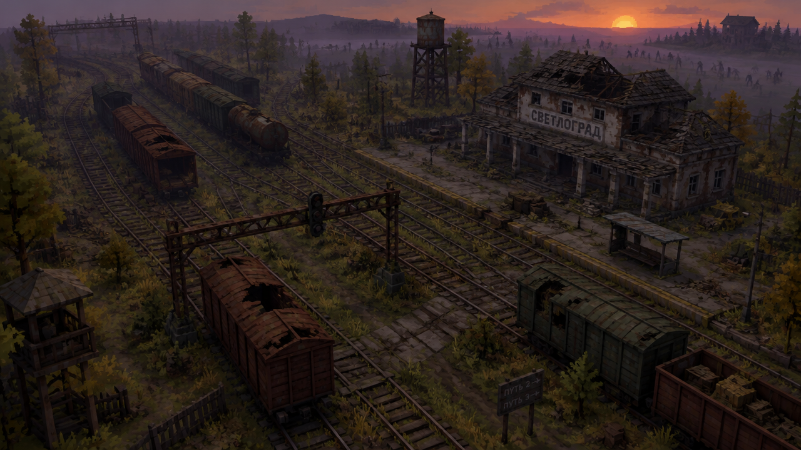

Prompt: *Game concept art: an abandoned railway junction at dusk, rusted freight cars on overgrown tracks, a ruined
station, silhouettes of zombies far in the distance, survival strategy game, low-poly 3D look with pixelated
shading, three-quarter overhead view, muted palette.*

## 3. Prueba 3D con Hunyuan (addon «Image to 3D» de Blender)

| Campo | Valor |
| --- | --- |
| Imagen de entrada | `docs/assets/mr-mak.png` (peluche del cerdito de mr.mak, imagen de muestra del repositorio) |
| Motor y ajustes | `HUNYUAN`, calidad `FAST`, 40.000 caras, textura 1K, sin vistas extra |
| Tiempo | **3 min 01 s** en la RTX 5080 |
| Resultado | 1 objeto, 1 malla, **40.000 caras**, 1 material, 1 mapa UV, `.glb` de 3,3 MB |
| Memoria de vídeo | Antes de pintar la textura: 4,88 GB en uso de torch, 10,62 GB libres de 17,07 GB. El pico no se midió. |

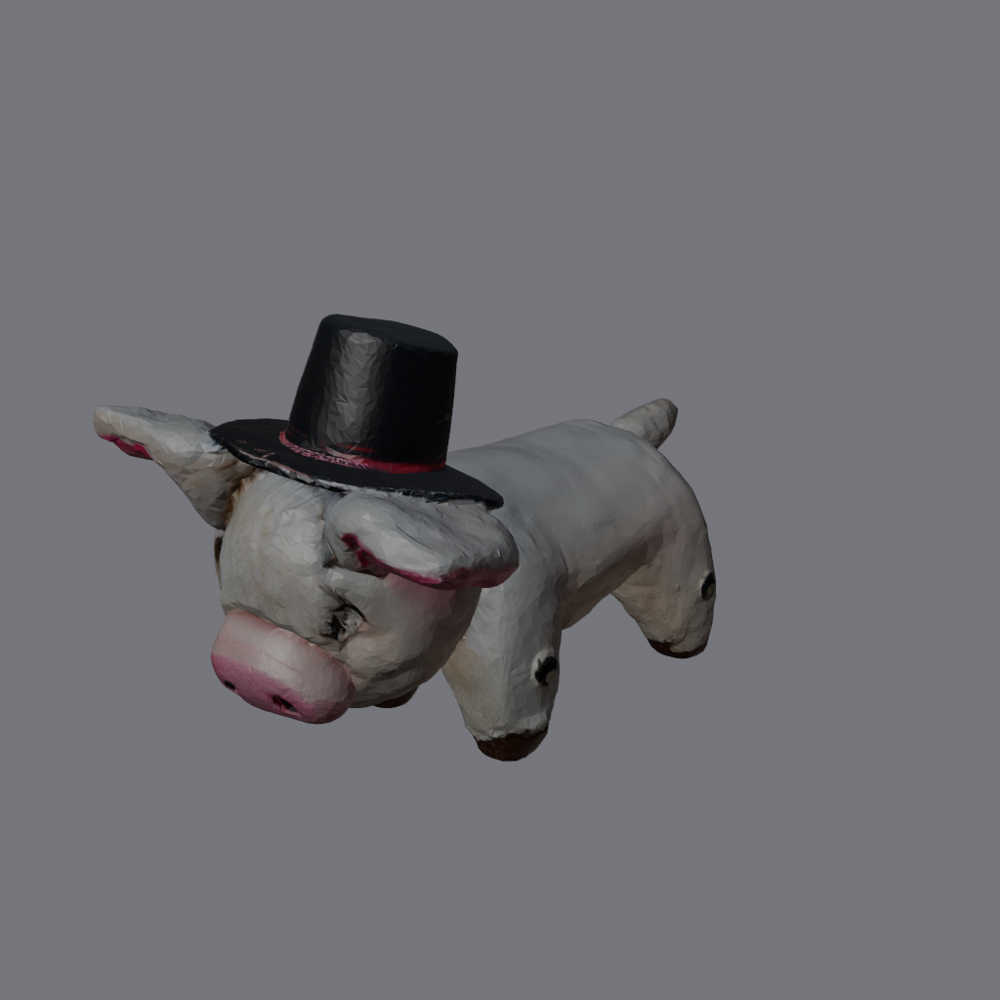

Archivo: `assets/3d/E4_prueba_hunyuan_mr-mak_40k.glb`. **Importante:** es una prueba con un objeto simple. No
demuestra que el motor sirva para un vehículo o un edificio; eso se comprobará con una imagen de concepto real.

### 3b. Hunyuan «More Views» (vistas múltiples)

Eugenio instaló «More Views» y el addon lo detecta como listo. Entradas: imagen principal = **frente**; `view_1` =
**atrás**, `view_2` = **izquierda**, `view_3` = **derecha** (todas opcionales; mismo objeto, misma luz, entero en el
encuadre). El motor carga entonces el modelo multivista Hunyuan3D-2mv (en el registro: «VIEWS 4»).

| Campo | Valor |
| --- | --- |
| Entradas | Frente = `mr-mak.png`; atrás, izquierda y derecha = tres renders ortográficos del modelo de la prueba anterior (`assets/3d/E4b_vistas/`) |
| Ajustes | `HUNYUAN`, `FAST`, 40.000 caras, textura 1K |
| Tiempo | **1 min 33 s** (la primera prueba tardó 3 min 01 s; la diferencia se debe sobre todo a que los modelos ya estaban cargados, no al método) |
| Resultado | 40.000 caras, `.glb` de 3,1 MB; más limpio y definido por detrás y por los lados (pata, sombrero, hocico) |

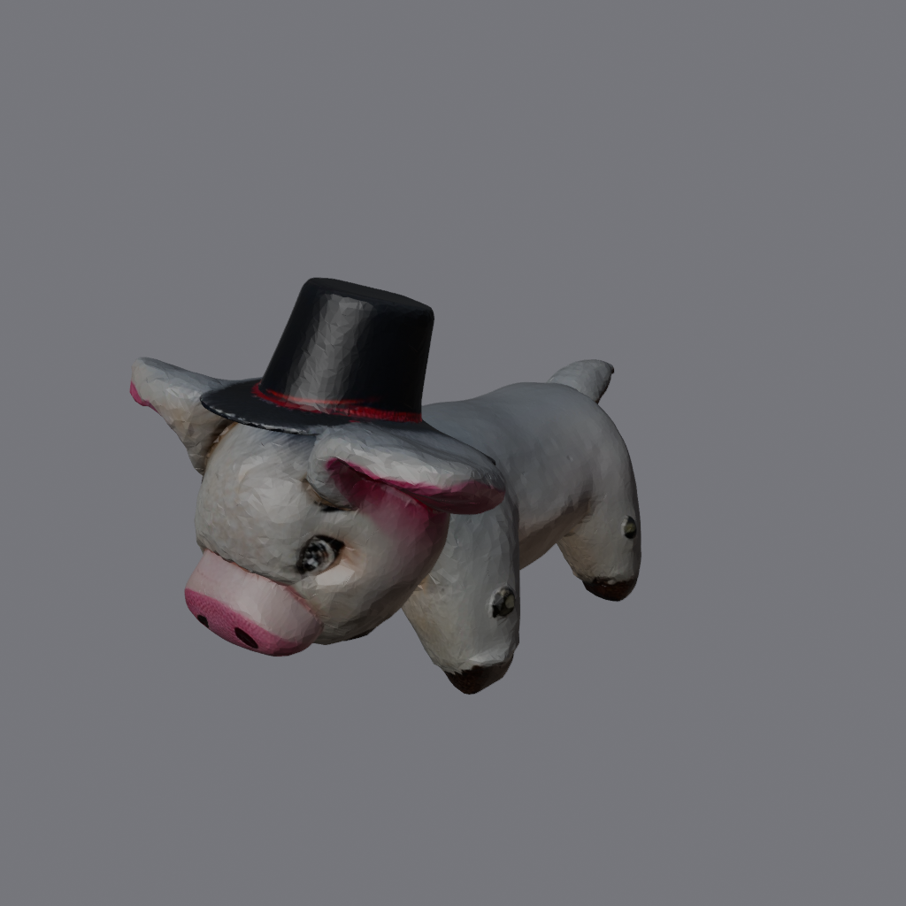
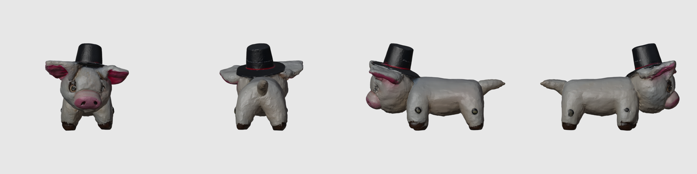

**Limitación:** las tres vistas salieron del propio modelo, así que la comparación es circular. Valida que el flujo
funciona; **no mide** cuánto mejora con vistas reales. Falta probar con una hoja de vistas hecha a partir de un
concepto (por ejemplo con GPT Image 2.5 o Nano Banana Pro).

Archivo: `assets/3d/E4b_prueba_hunyuan_more-views_mr-mak_40k.glb`.
